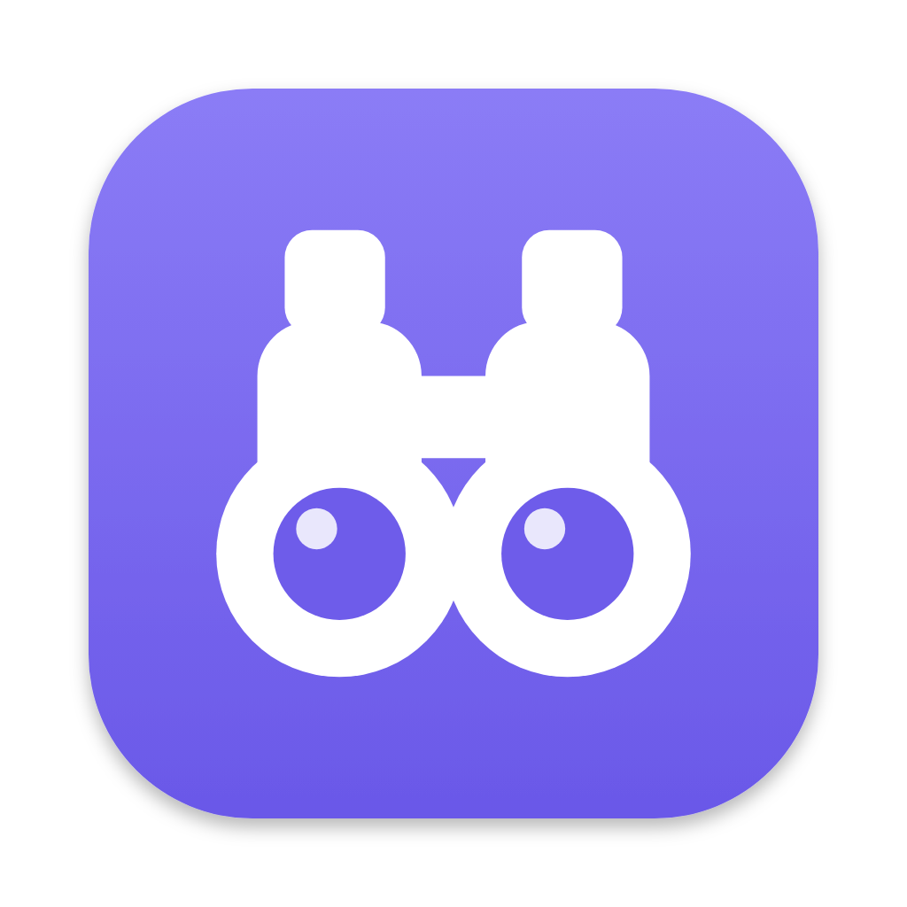
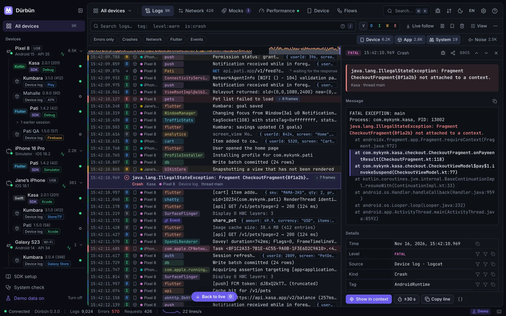
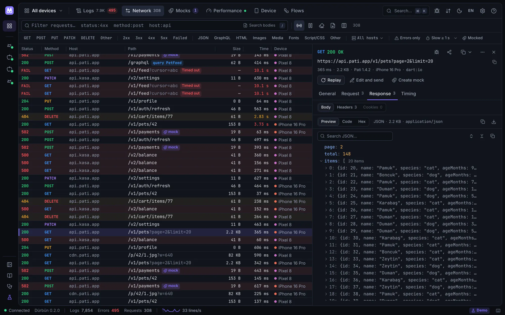
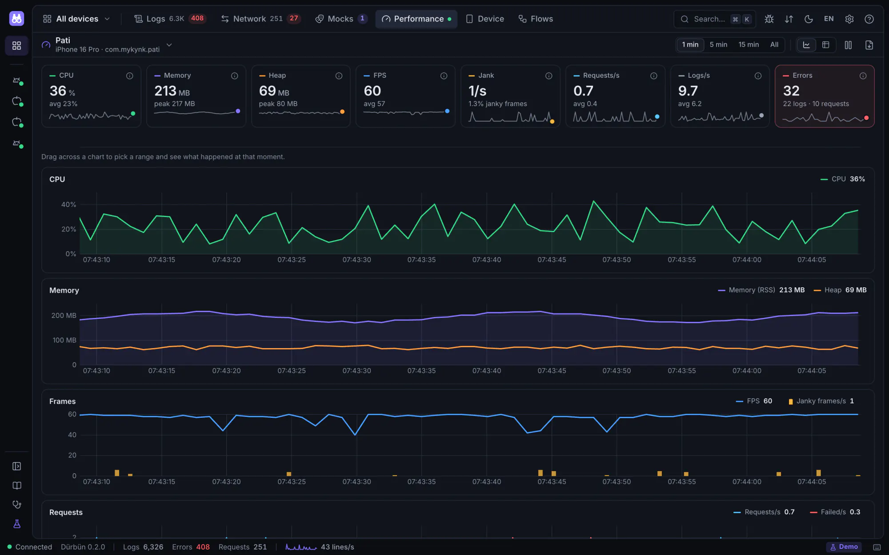
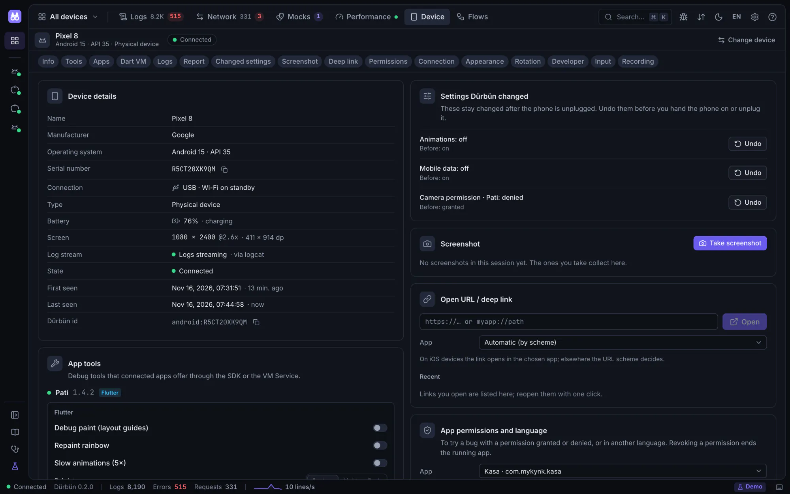
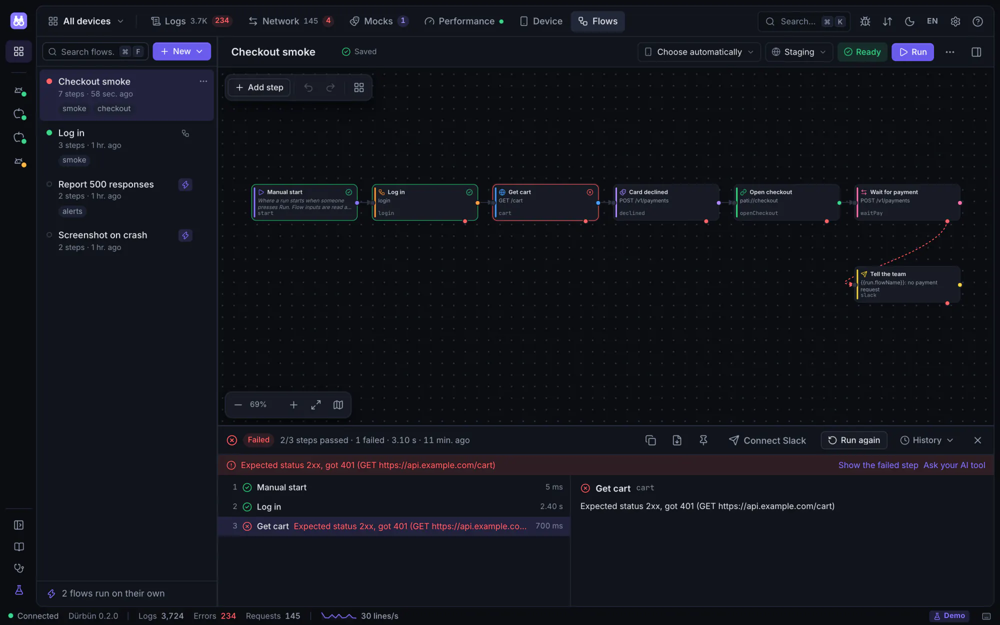

<p align="center">
  
</p>

<h1 align="center">Dürbün</h1>

<p align="center">
  Live logs, network traffic and performance for Android and iOS apps, on your Mac.
</p>

<p align="center">
  <a href="https://appnify.dev/durbun/">Website</a> · <a href="https://appnify.dev/durbun/#demo">Live demo</a>
</p>

<p align="center">
  <a href="https://pub.dev/packages/durbun"></a>
  <a href="LICENSE"></a>
</p>

<p align="center">
  English · <a href="README.tr.md">Türkçe</a> · <a href="docs/README.md">Docs</a>
</p>



Plug in an Android or iOS device, or start a simulator or emulator, and Dürbün shows everything the app
does in one readable, live window. *Dürbün* is Turkish for binoculars.

- **Logs.** Android logcat, the iOS device and simulator logs, your app's own logs, errors, crashes and
  events. Multi-line output, stack traces and JSON fold; repeated lines collapse into ×N; crashes stand out.
- **Network.** HTTP(S) requests with headers, bodies and timings, from the clients each SDK hooks into (see
  [What gets captured](#what-gets-captured)). Copy as cURL, fetch, Dio, Swift or OkHttp, resend or edit and
  send, compare two requests, export HAR. A WebSocket connection or a Server-Sent Events stream is one row
  with its messages in the order the app saw them.

  
- **Mocks.** Answer matching requests with a canned response, add latency or simulate a failure. A rule can
  target one GraphQL operation. The SDK applies the rules inside the app, so no proxy or certificate is
  involved (see [Mock rules](docs/guides/mocks.md)).
- **Performance.** CPU, memory, heap, FPS and jank, requests per second and logs per second.

  
- **Flows.** Tests you draw as a graph: requests sent from the Mac, checks, waits on what the app does, mock
  scenarios and device actions, chained and calling each other as sub-flows (see [Flows](#flows)). Write them
  by hand, from captured requests, or with your own AI assistant.
- **Share.** A log line or a request becomes a report your team can read without Dürbün: copy it, save it as
  Markdown, or send it to your team's Slack channel with one click (Settings → Slack). Getting the channel's
  webhook is one click too: [Add to Slack](https://appnify.dev/durbun/slack/). The Flutter in-app panel can
  send it from the phone too.
- **Session recordings.** Every run is saved on your Mac as it happens: after a quit or a crash you reopen the
  previous session, kept apart from live data. Nothing leaves the Mac.
- **Backups and sharing.** Your flows, mock rules, environments and settings in one `.durbun` file: share
  your setup with the team, or back everything up for a new Mac, by hand or automatically into iCloud Drive
  or any folder (see [Sharing and backups](#sharing-and-backups)).
- **Device tools.** Screenshots and screen recording, deep links, launch, stop, install and uninstall apps,
  dark mode, font size, location, simulator push notifications, status bar overrides, and buttons your app
  adds itself.

  

Device logs need no SDK. Flutter debug apps without the SDK are attached automatically through the Dart VM
Service. The SDKs add app logs, network capture, metrics and mocks.

The interface is available in English and Turkish and follows your system language.

## Install

### Mac app

Download the DMG for your Mac from [GitHub Releases](https://github.com/mykynk/durbun/releases/latest):
`Durbun-<version>-arm64.dmg` for Apple silicon, `Durbun-<version>-x64.dmg` for Intel. Open it and drag
Dürbün to Applications. Requires macOS 13 Ventura or later.

Release builds are signed with a Developer ID and notarized by Apple, so they open like any other app.

**Dürbün → Check for Updates…** looks for a new version. If one is out, Dürbün shows what is new and asks
before it downloads, then asks again before it restarts. A copy that cannot replace itself (a local build, or
one opened from the disk image) gets the disk image for your Mac instead. From the second launch on, Dürbün
asks once whether it may check by itself once a day; change it any time with
**Dürbün → Check for Updates Automatically**.

### Requirements

| For | You need |
|---|---|
| The Mac app | macOS 13 or later (Node.js is built in) |
| The command line (`npm start`) | Node.js 20 or later |
| Android devices and emulators | `adb` (Android SDK Platform-Tools) |
| iOS simulators | Xcode (`xcrun simctl`) |
| Physical iOS devices | Xcode and `idevicesyslog` (`brew install libimobiledevice`; the copy in Flutter's cache also works) |

The **System check** screen in the app tells you what is missing and how to fix it. For everything else, see
[Troubleshooting](docs/guides/troubleshooting.md).

### Try it without a device

```bash
git clone https://github.com/mykynk/durbun.git && cd durbun
npm install
npm run demo
```

The demo starts with simulated devices, apps, logs and network traffic.

## Add the SDK to your app

The **SDK setup** screen in the app shows the same steps with copyable snippets.

| Platform | Install | Guide |
|---|---|---|
| Flutter | [`durbun`](https://pub.dev/packages/durbun) on pub.dev, plus [`durbun_dio`](https://pub.dev/packages/durbun_dio) for Dio's native adapters | [sdks/flutter/durbun](sdks/flutter/durbun/README.md) |
| iOS (Swift, URLSession) | Swift Package Manager: `https://github.com/mykynk/durbun` from `0.2.0`; CocoaPods: `pod 'Durbun'` | [sdks/ios](sdks/ios/README.md) |
| Android (Kotlin, OkHttp) | [`io.github.mykynk:durbun`](https://central.sonatype.com/artifact/io.github.mykynk/durbun) on Maven Central, plus `durbun-noop` for release builds | [sdks/android](sdks/android/README.md) |
| React Native / JavaScript | [`@durbun/react-native`](https://www.npmjs.com/package/@durbun/react-native) on npm | [sdks/js](sdks/js/README.md) |

The SDKs are off in release builds unless you turn them on; each guide shows how, and
[Dürbün in test builds](docs/guides/qa-builds.md) covers Firebase App Distribution, TestFlight and ad hoc
builds. They connect on their own: `adb reverse` on Android, `127.0.0.1:9751` on simulators, and usbmux on
iPhones for the Flutter and iOS SDKs. A React Native app on an iPhone connects over Wi-Fi only: turn on
**Settings → Connection → Allow local network (Wi-Fi) connections** and pass the Mac's IP address
(`Durbun.start({ host: '192.168.1.20' })`). Wi-Fi works for every SDK once local network connections are
allowed.

## Guides

Every guide, sorted by reader, is listed in [the docs index](docs/README.md).

| Guide | For |
|---|---|
| [Dürbün for testers](docs/guides/testers.md) | Testers: install, USB debugging on Android, "Trust This Computer" on iPhone, finding your app, reporting what you found |
| [Troubleshooting](docs/guides/troubleshooting.md) | By symptom: the phone does not appear, no iPhone logs, requests missing, the app does not connect, ports |
| [Mock rules](docs/guides/mocks.md) | Writing rules, matching and order, what happens inside the app, recipes, limits |
| [Dürbün in test builds](docs/guides/qa-builds.md) | Turning the SDK on in staging, Firebase, TestFlight and ad hoc builds |
| [Versions and upgrades](docs/guides/versions.md) | Which SDK works with which Mac app, and how to upgrade |
| [Flow files](docs/flows/README.md) | The flow file format |

## What gets captured

| Your app | Logs | Network | Performance | Mocks |
|---|---|---|---|---|
| Any app, no SDK | Device logs (logcat, iOS device and simulator logs) and system crash records | No | Android process and frame statistics | No |
| Flutter debug or profile build, no SDK (through the Dart VM Service) | Adds `dart:developer` `log()` and Flutter errors | dart:io HTTP: `package:http`, Dio's default adapter | FPS, jank, Dart heap | No |
| Flutter with `durbun` | Adds `Durbun.log`, `debugPrint`, crashes and native logs | dart:io HTTP, plus URLSession on iOS and OkHttp with `DurbunInterceptor` on Android | FPS, jank, memory, CPU | Yes |
| iOS with `Durbun` | Adds `Durbun.log`, `print` and stderr, crashes | `URLSession.shared` and your own sessions, Alamofire included | CPU, memory, threads, FPS, jank | Yes |
| Android with `durbun` | Adds `Durbun.log` (Timber too) and crashes | `OkHttpClient`s with `DurbunInterceptor`: Retrofit, Coil, Ktor's OkHttp engine | CPU, memory, Java heap, threads, FPS, jank | Yes |
| React Native with `@durbun/react-native` | Adds `console.*` and JS errors | `XMLHttpRequest`: `fetch`, axios | JS heap, JS-thread FPS | Yes |

WebSocket messages and Server-Sent Events need an SDK: Flutter (dart:io WebSockets and event streams), iOS
(`URLSessionWebSocketTask` and event streams over URLSession), Android (event streams with
`DurbunInterceptor`; WebSockets opened through `DurbunWebSocketFactory`) and React Native (the global
`WebSocket`, event streams from `XMLHttpRequest`-based libraries). Without an SDK a connection shows its
handshake only. The Flutter in-app panel shows the messages on the phone too, without the Mac.

Not captured:

- **Flutter:** gRPC and raw sockets, WebSockets that do not run on dart:io (report them with
  `DurbunNetwork.webSocket`), `print` in background isolates and their requests until they call
  `Durbun.attachIsolate()`, and on Android package:http's `CronetClient` and `package:ok_http`. Dio's
  `NativeAdapter` needs [`durbun_dio`](https://pub.dev/packages/durbun_dio).
- **iOS:** background URLSessions, AVPlayer traffic, WebSocket libraries that do not use URLSession
  (Starscream's own engine, SocketRocket). A `WKWebView` page shows its fetch/XHR calls and console lines
  after `DurbunWebView.attach(...)`; its page loads and images do not show.
- **Android:** `HttpURLConnection` (Volley, Media3's default data source, Ktor's CIO engine), Cronet and native
  code. A `WebView` page shows its fetch/XHR calls and console lines after `DurbunWebView.attach(webView)`; its
  page loads and images do not show. gRPC streams show their size only; a WebSocket opened with `client.newWebSocket` shows its
  handshake only.
- **React Native:** `<Image>` downloads, requests made by native modules and WebSocket classes that come from
  a package instead of the global `WebSocket`.

Each SDK guide has the details, and shows how to report other clients yourself.

## Flows

The **Flows** tab chains what you test by hand into a graph you can run again. Each step is a node; arrows
decide what runs next, and a step that fails leaves through its error arrow when you draw one.



| Group | Nodes |
| --- | --- |
| Start | Run by hand (with inputs), or start by itself when something happens: a crash, a matching or failing request, a log line, an app or a device connecting |
| Requests | HTTP request from the Mac, with headers, body, timeouts and values picked from the response |
| Logic | Condition, repeat (a count or a list), set variables, wait, call another flow, end |
| Checks | Assert rules on any value, no errors in the logs |
| Wait for the app | A request, a log line or an event from the app, with a time limit |
| Mocks | Add, switch or remove a mock rule for the scenario; the flow's own rules go when the run ends |
| Device | Open a link, launch, stop or restart the app, clear its data, install or uninstall, screenshot, screen recording, dark mode, font size, location, push notification, text and keys, status bar, animations |
| Report | Marker in the logs, note in the run report, Slack message |

- Values flow with templates: `{{login.body.token}}` reads the `login` step's response, `{{env.baseUrl}}` the
  chosen environment, `{{input.email}}` a run input. The editor completes them as you type.
- **Environments** (Staging, Production…) hold addresses and keys. Secret values stay on this Mac and are
  masked in reports.
- Before a run Dürbün checks what the flow needs (a device, an app, an SDK connection, a tool) and says what
  is missing; steps that change the device for good (clear data, uninstall) ask first.
- The run panel shows each step live with its timing, request and response, screenshots and recordings. The
  last 200 runs are kept.
- **From captured requests:** pick requests in Network (or **Create a flow from this request…** on one) and
  Dürbün builds the flow, moves the host into an environment variable and feeds values from one response into
  the next request.
- **With your own AI:** Dürbün never calls an AI. **Write with AI** copies a pack (the flow format, every node
  type, your flows, environment keys and the app's recent requests, without headers, bodies or query values)
  to paste into the assistant you use. Paste its
  answer back; Dürbün checks it, shows what is new or changed and imports it. The format is public: see
  [Flow files](docs/flows/README.md) and [`durbun-flow.schema.json`](docs/flows/durbun-flow.schema.json).
- Flows are plain JSON files in `~/.durbun/flows`, one per flow, so they also fit in a repository.

Steps that need the SDK (waits on app events, mock rules) say so before the run; device steps work without it.

## Sharing and backups

Dürbün has no cloud, so your work lives in `~/.durbun` on this Mac. A `.durbun` package carries it elsewhere:

- **Share your setup…** (Import / export menu, or **Share with the team…** on a flow): the flows you pick
  with the sub-flows they call, mock rules, environments, settings, look and log rules, and optionally run
  history. Secret environment values and the Slack link never go in.
- **Back up everything…**: one file for a new Mac. Secret values and the Slack link go in only when you set a
  passphrase, encrypted (AES-256-GCM, key from scrypt); without one they are left out.
- **Settings → Backup** writes a backup into a folder you choose after changes (at most once an hour) and on a
  schedule, keeping the newest ones. A synced folder such as iCloud Drive carries them to your other Mac; there,
  **Restore…** opens one. The passphrase for automatic backups is kept on this Mac only.
- Opening a package (**Import a file…**, or drop it on the window) shows what is new, what already exists and
  what differs, and lets you replace, keep both or skip. Nothing is overwritten before you choose.

## Privacy

- Dürbün sends nothing off your Mac on its own: no analytics, no telemetry. If you allow automatic update
  checks, Dürbün reads one static file from GitHub Releases once a day; the request carries no identifier.
  Crash dumps stay on the Mac.
- Requests leave the Mac only when you ask: **Check for Updates** (one static file from GitHub Releases; the
  update downloads only after your yes),
  resending a captured request (to that request's own host), **Send to Slack** (to the webhook you set) and
  flows (their HTTP and Slack steps go where the flow says; a flow set to start on an event runs only while
  Dürbün is open). Backups are written to the folder you choose; syncing it is up to that folder's service.
- The server listens on `127.0.0.1` only. Turn on **LAN** in Settings (or pass `--lan`) to let devices on
  the same network reach the SDK port.
- The SDKs contact no other service: what they capture goes only over the Dürbün connection (see
  [Security](#security)). The one exception is the Flutter in-app panel's **Send to Slack**, which posts a
  report to the webhook you built the app with, and only when someone taps it.

## Security

The interface and its API answer only connections from this Mac, and only Dürbün's own pages, so websites open
in your browser cannot read them. `adb reverse` points at a separate port that serves the SDK connection and
nothing else, so apps on a plugged-in phone cannot read them either. With LAN on, other devices reach the SDK
connection only.

The SDK connection itself is not paired or encrypted yet:

- An app with the SDK on talks to whatever answers on its port: it sends that peer its logs and network
  traffic, and applies the peer's mock rules while it stays connected. On Android the SDK connects to
  `127.0.0.1:9751` on the device, which `adb reverse` forwards to the Mac. On an iOS device it listens on
  `127.0.0.1:9752–9755` (loopback only), and the Mac connects through usbmux. In both cases another app on the
  same device could take the Mac's place.
- Over Wi-Fi the traffic crosses the local network unencrypted.
- The SDKs are off in release builds unless you turn them on. Builds you turn them on for, such as internal
  test builds, behave as described here.
- Captured data can include tokens and personal data. Session exports and HAR files mask secret values
  (credential headers, cookies, token and password fields) unless you choose an unmasked export; text inside
  log lines is not masked. To keep a value off the Mac altogether, hide it with each SDK's `redactHeaders`
  option.
- A Slack incoming webhook URL lets anyone who has it post to its channel. The Mac app keeps it in
  `slack.json` in its data folder (readable only by your user) and never shows it again. The Flutter panel's
  webhook comes from your build command (`--dart-define=DURBUN_SLACK_WEBHOOK`) and is compiled into that
  build, so whoever has the build can find it.
- Environment secrets and the backup passphrase are kept in the data folder, readable only by your user.
  Shared packages never contain them; backups contain them only encrypted with your passphrase. A flow runs
  the requests and device actions written in it, so open flows from people you trust, and read what an AI
  wrote before you run it. Requests sent from the Mac (flows and resends) cannot reach Dürbün's own ports.

Pairing between the SDKs and the Mac app is planned.

## The Mac app in detail

<details>
<summary>Ports, window, shell environment, quitting and diagnostics</summary>

- Dürbün runs its server inside the app and opens the interface in its own window; no terminal needed.
- Ports 9750 (interface) and 9751 (SDKs). If a Dürbün is already running, for example `npm start`, the app
  opens that one and starts its own server once the other stops; the menu bar icon tells you if the
  versions differ. The window only connects to a server that proves it is Dürbün (`/api/health` name and
  version, and the Dürbün interface at `/`). If another program holds the port, Dürbün tries 9760, 9770 and
  9780 and shows the port it uses in the menu bar.
- The window opens the server at `http://127.0.0.1:<port>`, not `localhost`, which tries `::1` first where
  another program may be listening.
- Menus and menu bar notices follow the interface language (the system language on first launch). The
  server's English text goes to the diagnostic log.
- The server and the interface ship inside `app.asar`; Electron's integrity check refuses to run a modified
  copy.
- Dürbün reads `PATH` and tool settings (`ANDROID_HOME`, `JAVA_HOME`, fvm, `DEVELOPER_DIR`) from your login
  shell, so `adb`, `flutter` and `idevicesyslog` are found as in Terminal. If the shell does not answer
  within 3 seconds, the menu bar icon says so.
- Closing the window does not stop capturing; Dürbün keeps running in the menu bar. Quit with ⌘Q or the
  menu bar icon → **Quit**, which stops the server cleanly.
- If the server cannot start, the window explains why and offers **Try Again**, **Show Diagnostic Log** and
  **Quit**. Help → **Report an Issue…** opens a new GitHub issue; Help → **Licenses** lists third-party
  licenses.

</details>

## Command line

```bash
npm install
npm run build
npm start
```

The interface opens at http://127.0.0.1:9750, in a chromeless app window when Chrome, Brave, Edge, Arc or
Chromium is installed.

```
node dist/durbun.mjs [--port 9750] [--sdk-port 9751] [--demo] [--no-open] [--lan]
                     [--data-dir ~/.durbun] [--ui-dir PATH] [--verbose]
```

Settings, mock rules, flows, environments and run history live in `~/.durbun`.

## Uninstall

1. If you turned on **Dürbün → Open at Login**, turn it off first (or remove Dürbün later in System Settings →
   General → Login Items).
2. Quit Dürbün (⌘Q) and move it from Applications to the Trash. A normal quit removes the port forwards
   Dürbün set up on plugged-in Android phones. If Dürbün did not quit normally, remove them with
   `adb reverse --remove-all` (this also removes forwards other tools set on that phone).
3. To remove its data as well, delete:
   - `~/.durbun` (or the folder you passed with `--data-dir`): settings (`settings.json`), mock rules
     (`mocks.json`), flows (`flows/`), run history (`flow-runs/`), environments (`environments.json`), backup
     settings (`backup.json`), the Slack webhook (`slack.json`) and temporary files. Backups you wrote into
     another folder stay there.
   - `~/Library/Application Support/Dürbün`: window state, interface preferences, the app's own settings
     (`desktop.json`), the diagnostic log (`logs/`) and crash dumps (`Crashpad/`).
   - `~/Library/Preferences/dev.durbun.desktop.plist`: what macOS keeps for the app.
   - `~/Library/Saved Application State/dev.durbun.desktop.savedState`: the window state macOS saves, if
     present.
4. Remove the SDK packages from your apps.

## Contributing

Building from source, the Mac app build, development commands and the repository layout are in
[CONTRIBUTING.md](CONTRIBUTING.md). To report a vulnerability, see [SECURITY.md](SECURITY.md).

## Versioning

Dürbün follows [Semantic Versioning](https://semver.org). The Mac app, the server and every SDK share one
version and are released together from a `vX.Y.Z` tag on `main`; changes are listed in
[CHANGELOG.md](CHANGELOG.md). While the version is `0.x`, minor releases may include breaking changes.

The parts do not have to be upgraded together: from 0.1.0 on, the Mac app accepts apps built with any SDK
version and the SDKs accept any Mac app, since both sides ignore what they do not know. A new feature works once both sides
have it. See [Versions and upgrades](docs/guides/versions.md).

## License

[MIT](LICENSE) © 2026 Muhammed Yusuf Kaynak
