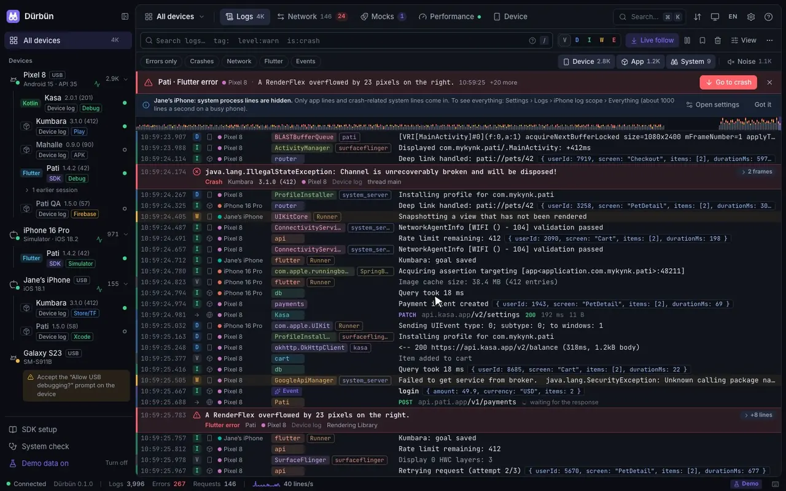

<p align="center">
  
</p>

<h1 align="center">Dürbün</h1>

<p align="center">
  Android ve iOS uygulamaları için Mac'te canlı log, ağ trafiği ve performans.
</p>

<p align="center">
  <a href="https://pub.dev/packages/durbun"></a>
  <a href="LICENSE"></a>
</p>

<p align="center">
  <a href="README.md">English</a> · Türkçe
</p>



Android veya iOS cihazı takın ya da simülatör/emülatör açın: Dürbün uygulamanın yaptığı her şeyi tek, okunaklı
ve canlı bir pencerede gösterir.

- **Loglar.** Android logcat, iOS cihaz ve simülatör logları, uygulamanın kendi logları, hatalar, çökmeler ve
  event'ler. Çok satırlı çıktılar, stack trace'ler ve JSON katlanır; aynı satırlar ×N olarak birleşir;
  çökmeler göze batar.
- **Ağ.** Her SDK'nın bağlandığı istemcilerden gelen HTTP(S) istekleri, başlıkları, gövdeleri ve
  zamanlamalarıyla (bkz. [Ne yakalanır](#ne-yakalanır)). cURL, fetch, Dio, Swift veya OkHttp olarak kopyalama,
  yeniden ya da düzenleyip gönderme, iki isteği karşılaştırma, HAR olarak dışa aktarma.
- **Mock'lar.** Eşleşen isteklere hazır yanıt verme, gecikme ekleme veya hata simüle etme. Kuralları SDK
  uygulamanın içinde uygular; proxy ya da sertifika gerekmez.
- **Performans.** CPU, bellek, heap, FPS ve takılmalar, saniyede istek ve saniyede log.
- **Akışlar.** Graf olarak çizdiğiniz testler: Mac'ten gönderilen istekler, kontroller, uygulamanın
  yaptıklarını bekleme, mock senaryoları ve cihaz işlemleri; birbirine zincirlenir, birbirini alt akış olarak
  çağırır (bkz. [Akışlar](#akışlar)). Elle, kayıtlı isteklerden ya da kendi yapay zekâ asistanınızla yazın.
- **Paylaşma.** Bir log satırı ya da istek, ekibinizin Dürbün olmadan okuyabileceği bir rapora dönüşür:
  kopyalayın, Markdown olarak kaydedin ya da tek tıkla ekibinizin Slack kanalına gönderin (Ayarlar → Slack).
  Kanalın webhook adresini almak da tek tık: [Slack'e ekle](https://appnify.dev/durbun/slack/?lang=tr).
  Flutter uygulama içi paneli de telefondan gönderebilir.
- **Yedekleme ve paylaşım.** Akışlarınız, mock kurallarınız, ortamlarınız ve ayarlarınız tek bir `.durbun`
  dosyasında: kurulumunuzu takımla paylaşın ya da yeni bir Mac için her şeyi yedekleyin; elle ya da iCloud
  Drive'a veya istediğiniz klasöre otomatik (bkz. [Paylaşım ve yedekleme](#paylaşım-ve-yedekleme)).
- **Cihaz araçları.** Ekran görüntüsü ve ekran kaydı, deep link, uygulama başlatma, durdurma, kurma ve
  kaldırma, koyu mod, yazı boyutu, konum, simülatöre push bildirimi, durum çubuğu ve uygulamanın kendi
  eklediği butonlar.

Cihaz logları SDK olmadan da gelir. SDK'sı olmayan Flutter debug uygulamalarına Dürbün Dart VM Service
üzerinden kendiliğinden bağlanır. Uygulama logları, ağ yakalama, ölçümler ve mock'lar için SDK eklenir.

Arayüz İngilizce ve Türkçedir, sistem dilini izler.


## Kurulum

### Mac uygulaması

Mac'inize uygun DMG'yi [GitHub Releases](https://github.com/mykynk/durbun/releases/latest) sayfasından
indirin: Apple silicon için `Durbun-<sürüm>-arm64.dmg`, Intel için `Durbun-<sürüm>-x64.dmg`. Açıp Dürbün'ü
Uygulamalar klasörüne sürükleyin. macOS 13 Ventura veya üstü gerekir.

Yayın paketleri Developer ID ile imzalı ve Apple onaylıdır (notarized); her uygulama gibi açılır.

Dürbün kendiliğinden güncelleme aramaz. **Dürbün → Güncellemeleri Denetle…** yeni bir sürüm varsa indirme
sayfasını açar.

### Gereksinimler

| Ne için | Gereken |
|---|---|
| Mac uygulaması | macOS 13 veya üstü (Node.js içinde gelir) |
| Komut satırı (`npm start`) | Node.js 20 veya üstü |
| Android cihaz ve emülatör | `adb` (Android SDK Platform-Tools) |
| iOS simülatör | Xcode (`xcrun simctl`) |
| iOS fiziksel cihaz | Xcode ve `idevicesyslog` (`brew install libimobiledevice`; Flutter önbelleğindeki kopya da olur) |

Uygulamadaki **Sistem kontrolü** ekranı eksik olanı ve nasıl tamamlanacağını söyler.

### Cihazsız denemek

```bash
git clone https://github.com/mykynk/durbun.git && cd durbun
npm install
npm run demo
```

Demo; sanal cihazlar, uygulamalar, loglar ve ağ trafiğiyle açılır.

## Uygulamaya SDK ekleme

Uygulamadaki **SDK kurulumu** ekranı aynı adımları kopyalanabilir haliyle gösterir.

| Platform | Kurulum | Kılavuz |
|---|---|---|
| Flutter | pub.dev'de [`durbun`](https://pub.dev/packages/durbun); Dio'nun native adaptörleri için [`durbun_dio`](https://pub.dev/packages/durbun_dio) | [sdks/flutter/durbun](sdks/flutter/durbun/README.md) |
| iOS (Swift, URLSession) | Swift Package Manager: `0.2.0` sürümünden itibaren `https://github.com/mykynk/durbun`; CocoaPods: `pod 'Durbun'` | [sdks/ios](sdks/ios/README.md) |
| Android (Kotlin, OkHttp) | Maven Central'da [`io.github.mykynk:durbun`](https://central.sonatype.com/artifact/io.github.mykynk/durbun); release derlemeleri için `durbun-noop` | [sdks/android](sdks/android/README.md) |
| React Native / JavaScript | npm'de [`@durbun/react-native`](https://www.npmjs.com/package/@durbun/react-native) | [sdks/js](sdks/js/README.md) |

SDK'lar release derlemelerinde siz açmadıkça kapalıdır; nasıl açılacağı her kılavuzda yazar. Bağlantıyı
kendileri kurar: Android'de `adb reverse`, iOS cihazda usbmux, simülatörde `127.0.0.1:9751`. LAN
bağlantılarına izin verirseniz Wi-Fi üzerinden de çalışır.

## Ne yakalanır

| Uygulamanız | Loglar | Ağ | Performans | Mock'lar |
|---|---|---|---|---|
| Herhangi bir uygulama, SDK yok | Cihaz logları (logcat, iOS cihaz ve simülatör logları) ve sistemin çökme kayıtları | Hayır | Android süreç ve kare istatistikleri | Hayır |
| Flutter debug veya profile derlemesi, SDK yok (Dart VM Service üzerinden) | Ek olarak `dart:developer` `log()` ve Flutter hataları | dart:io HTTP: `package:http`, Dio'nun varsayılan adaptörü | FPS, takılmalar, Dart heap | Hayır |
| `durbun` eklenmiş Flutter | Ek olarak `Durbun.log`, `debugPrint`, çökmeler ve native loglar | dart:io HTTP; iOS'ta URLSession, Android'de `DurbunInterceptor` eklenmiş OkHttp | FPS, takılmalar, bellek, CPU | Evet |
| `Durbun` eklenmiş iOS | Ek olarak `Durbun.log`, `print` ve stderr, çökmeler | `URLSession.shared` ve kendi oturumlarınız, Alamofire dahil | CPU, bellek, thread'ler, FPS, takılmalar | Evet |
| `durbun` eklenmiş Android | Ek olarak `Durbun.log` (Timber da) ve çökmeler | `DurbunInterceptor` eklenmiş `OkHttpClient`'lar: Retrofit, Coil, Ktor'un OkHttp motoru | CPU, bellek, Java heap, thread'ler, FPS, takılmalar | Evet |
| `@durbun/react-native` eklenmiş React Native | Ek olarak `console.*` ve JS hataları | `XMLHttpRequest`: `fetch`, axios | JS heap, JS thread FPS'i | Evet |

Yakalanmayanlar:

- **Flutter:** gRPC ve doğrudan socket kullanan kod, WebSocket mesajları (el sıkışma görünür), arka plan
  isolate'lerindeki istekler ve loglar (`compute`, `Isolate.run`), Android'de package:http'nin `CronetClient`'ı
  ve `package:ok_http`. Dio'nun `NativeAdapter`'ı için [`durbun_dio`](https://pub.dev/packages/durbun_dio)
  gerekir.
- **iOS:** arka plan URLSession'ları, WKWebView ve AVPlayer trafiği.
- **Android:** `HttpURLConnection` (Volley, Media3'ün varsayılan veri kaynağı, Ktor'un CIO motoru), Cronet,
  WebView ve native kod. WebSocket, gRPC ve SSE akışlarının yalnızca boyutu görünür.
- **React Native:** `<Image>` indirmeleri ve native modüllerin yaptığı istekler.

Ayrıntılar ve diğer istemcileri kendiniz nasıl bildireceğiniz her SDK'nın kılavuzunda.

## Akışlar

**Akışlar** sekmesi elle test ettiklerinizi tekrar çalıştırılabilen bir grafa dönüştürür. Her adım bir
düğümdür; oklar sırada neyin çalışacağını belirler, bir hata oku çizdiyseniz başarısız adım oradan devam eder.

| Grup | Düğümler |
| --- | --- |
| Başlangıç | Elle çalıştırma (girdilerle) ya da bir şey olunca kendiliğinden başlama: çökme, eşleşen ya da başarısız istek, log satırı, uygulamanın ya da cihazın bağlanması |
| İstekler | Mac'ten HTTP isteği; başlıklar, gövde, zaman aşımları ve yanıttan alınan değerlerle |
| Mantık | Koşul, tekrar (sayı ya da liste), değişken atama, bekleme, başka akışı çağırma, bitiş |
| Kontroller | Herhangi bir değer üzerinde kurallar, loglarda hata olmaması |
| Uygulamayı bekleme | Uygulamadan bir istek, log satırı ya da event; süre sınırıyla |
| Mock'lar | Senaryo için mock kuralı ekleme, açıp kapama ya da kaldırma; akışın kendi kuralları çalışma bitince kalkar |
| Cihaz | Link açma, uygulamayı başlatma, durdurma ya da yeniden başlatma, verisini silme, kurma ya da kaldırma, ekran görüntüsü, ekran kaydı, koyu mod, yazı boyutu, konum, push bildirimi, metin ve tuşlar, durum çubuğu, animasyonlar |
| Rapor | Loglara işaret, çalışma raporuna not, Slack mesajı |

- Değerler şablonlarla akar: `{{login.body.token}}` `login` adımının yanıtını, `{{env.baseUrl}}` seçili
  ortamı, `{{input.email}}` bir çalışma girdisini okur. Editör yazarken tamamlar.
- **Ortamlar** (Staging, Production…) adresleri ve anahtarları tutar. Gizli değerler bu Mac'te kalır ve
  raporlarda maskelenir.
- Çalıştırmadan önce Dürbün akışın neye ihtiyacı olduğunu (cihaz, uygulama, SDK bağlantısı, araç) denetler ve
  eksik olanı söyler; cihazı kalıcı olarak değiştiren adımlar (veri silme, kaldırma) önce sorar.
- Çalıştırma paneli her adımı canlı olarak süresi, isteği ve yanıtı, ekran görüntüleri ve kayıtlarıyla
  gösterir. Son 200 çalıştırma saklanır.
- **Kayıtlı isteklerden:** Ağ'da istekleri seçin (ya da tek bir istekte **Bu istekten akış oluştur…**);
  Dürbün akışı kurar, adresi bir ortam değişkenine taşır ve bir yanıttaki değerleri sonraki isteğe bağlar.
- **Kendi yapay zekânızla:** Dürbün hiçbir yapay zekâya istek atmaz. **Yapay zekâyla yaz**, kullandığınız
  asistana yapıştırmanız için bir paket kopyalar (akış biçimi, tüm düğüm türleri, akışlarınız, ortam anahtarları
  ve uygulamanın son istekleri; başlıklar, gövdeler ve sorgu değerleri olmadan). Cevabını geri yapıştırın; Dürbün denetler, neyin yeni ya da değişmiş olduğunu gösterir
  ve içe aktarır. Biçim herkese açık: [Akış dosyaları](docs/flows/README.md) (İngilizce) ve
  [`durbun-flow.schema.json`](docs/flows/durbun-flow.schema.json).
- Akışlar `~/.durbun/flows` içinde, her akış için bir düz JSON dosyasıdır; bir repoya da koyabilirsiniz.

SDK gerektiren adımlar (uygulama event'lerini bekleme, mock kuralları) bunu çalıştırmadan önce söyler; cihaz
adımları SDK'sız çalışır.

## Paylaşım ve yedekleme

Dürbün'ün bulutu yok; yaptıklarınız bu Mac'te `~/.durbun` içinde durur. Bir `.durbun` paketi onları başka
yere taşır:

- **Kurulumu paylaş…** (İçe / dışa aktar menüsü ya da bir akışta **Takımla paylaş…**): seçtiğiniz akışlar ve
  çağırdıkları alt akışlar, mock kuralları, ortamlar, ayarlar, görünüm ve log kuralları, isterseniz
  çalıştırma geçmişi. Gizli ortam değerleri ve Slack bağlantısı asla girmez.
- **Her şeyi yedekle…**: yeni bir Mac için tek dosya. Gizli değerler ve Slack bağlantısı yalnızca parola
  verirseniz şifreli girer (AES-256-GCM, anahtar scrypt ile); parola yoksa dışarıda kalır.
- **Ayarlar → Yedekleme**, seçtiğiniz klasöre değişikliklerden sonra (en fazla saatte bir) ve belirlediğiniz
  aralıkta yedek yazar, en yenilerini tutar. iCloud Drive gibi eşitlenen bir klasör yedekleri diğer Mac'inize
  taşır; orada **Geri yükle…** birini açar. Otomatik yedeklerin parolası yalnızca bu Mac'te saklanır.
- Bir paketi açmak (**Dosya içe aktar…** ya da pencereye bırakmak) neyin yeni olduğunu, neyin zaten var
  olduğunu ve neyin farklı olduğunu gösterir; yerine koymayı, ikisini de tutmayı ya da atlamayı seçersiniz.
  Siz seçmeden hiçbir şeyin üzerine yazılmaz.

## Gizlilik

- Dürbün kendiliğinden Mac'in dışına hiçbir şey göndermez: analitik, telemetri ya da otomatik güncelleme
  denetimi yoktur. Çökme dökümleri Mac'te kalır.
- Mac'ten dışarı istek yalnızca siz istediğinizde çıkar: **Güncellemeleri Denetle** (GitHub API'ye tek
  istek), yakalanmış bir isteği yeniden göndermek (isteğin kendi adresine), **Slack'e gönder** (ayarladığınız
  webhook'a) ve akışlar (HTTP ve Slack adımları akışta yazan yere gider; bir olayda kendiliğinden başlayan akış
  yalnızca Dürbün açıkken çalışır). Yedekler seçtiğiniz klasöre yazılır; o klasörü eşitlemek klasörün
  servisine kalmıştır.
- Sunucu yalnızca `127.0.0.1`'i dinler. Aynı ağdaki cihazların SDK portuna bağlanması için Ayarlar'da
  **LAN**'ı açın (ya da `--lan` verin).
- SDK'lar başka hiçbir servise bağlanmaz: yakaladıkları yalnızca Dürbün bağlantısından gider (bkz.
  [Güvenlik](#güvenlik)). Tek istisna Flutter uygulama içi panelinin **Slack'e gönder**'idir: raporu,
  uygulamayı derlerken verdiğiniz webhook'a, yalnızca biri dokunduğunda gönderir.

## Güvenlik

Arayüz ve API'si yalnızca bu Mac'ten gelen bağlantılara ve yalnızca Dürbün'ün kendi sayfalarına yanıt verir;
tarayıcınızda açık siteler bunları okuyamaz. `adb reverse` yalnızca SDK bağlantısına hizmet eden ayrı bir
porta yönlenir; takılı telefondaki uygulamalar da bunları okuyamaz. LAN açıkken diğer cihazlar yalnızca SDK
bağlantısına ulaşır.

SDK bağlantısında henüz eşleşme ve şifreleme yok:

- SDK'sı açık bir uygulama, portunda kim yanıt verirse onunla konuşur: loglarını ve ağ trafiğini ona
  gönderir, bağlı kaldığı sürece onun mock kurallarını uygular. Android'de SDK cihazdaki `127.0.0.1:9751`'e
  bağlanır; `adb reverse` bunu Mac'e iletir. iOS cihazda `127.0.0.1:9752–9755`'te dinler (yalnızca loopback)
  ve Mac usbmux üzerinden bağlanır. İki durumda da aynı cihazdaki başka bir uygulama Mac'in yerini alabilir.
- Wi-Fi'de trafik yerel ağdan şifresiz geçer.
- SDK'lar release derlemelerinde siz açmadıkça kapalıdır. Açtığınız derlemeler, örneğin iç test derlemeleri,
  burada anlatıldığı gibi davranır.
- Yakalanan veride token'lar ve kişisel veriler olabilir. Başlık değerlerini her SDK'nın `redactHeaders`
  seçeneğiyle gizleyin; dışa aktarmalar ve HAR dosyaları yakalanan her şeyi içerir.
- Slack incoming webhook adresine sahip olan herkes o kanala mesaj atabilir. Mac uygulaması adresi veri
  klasöründeki `slack.json` dosyasında (yalnızca sizin kullanıcınız okuyabilir) tutar ve bir daha göstermez.
  Flutter panelinin webhook'u derleme komutunuzdan gelir (`--dart-define=DURBUN_SLACK_WEBHOOK`) ve o derlemenin
  içine gömülür; derlemeye sahip olan onu bulabilir.
- Ortamların gizli değerleri ve yedek parolası veri klasöründe, yalnızca sizin kullanıcınızın okuyabileceği
  dosyalarda tutulur. Paylaşılan paketlerde asla bulunmaz; yedeklerde yalnızca parolanızla şifrelenmiş olarak
  bulunur. Bir akış içinde yazan istekleri ve cihaz işlemlerini çalıştırır; başkalarından gelen akışları
  güvendiğiniz kişilerden açın, yapay zekânın yazdığını çalıştırmadan önce okuyun.

SDK'larla Mac uygulaması arasında eşleşme planlanıyor.

## Mac uygulaması ayrıntıları

<details>
<summary>Portlar, pencere, kabuk ortamı, kapatma ve tanılama</summary>

- Dürbün sunucuyu uygulamanın içinde çalıştırır ve arayüzü kendi penceresinde açar; terminal gerekmez.
- Port 9750 (arayüz) ve 9751 (SDK'lar). Bir Dürbün zaten çalışıyorsa (ör. `npm start`) uygulama onu açar, o
  kapanınca kendi sunucusunu başlatır; sürümler farklıysa menü çubuğundaki simge söyler. Pencere yalnızca
  Dürbün olduğunu kanıtlayan bir sunucuya bağlanır (`/api/health` adı ve sürümü, `/` adresinde Dürbün
  arayüzü). Port başka bir programdaysa 9760, 9770 ve 9780'i dener ve kullandığı portu menü çubuğunda
  gösterir.
- Pencere sunucuyu `localhost` yerine `http://127.0.0.1:<port>` adresinden açar; `localhost` önce `::1`'i
  dener ve orada başka bir program olabilir.
- Menüler ve menü çubuğu uyarıları arayüzün dilini (ilk açılışta sistem dilini) izler. Sunucunun İngilizce
  metni tanılama günlüğüne yazılır.
- Sunucu ve arayüz `app.asar` içindedir; Electron'un bütünlük denetimi değiştirilmiş bir kopyayı
  çalıştırmaz.
- Dürbün `PATH`'i ve araç ayarlarını (`ANDROID_HOME`, `JAVA_HOME`, fvm, `DEVELOPER_DIR`) giriş kabuğunuzdan
  okur; `adb`, `flutter` ve `idevicesyslog` Terminal'deki gibi bulunur. Kabuk 3 saniyede yanıt vermezse
  menü çubuğundaki simge söyler.
- Pencereyi kapatmak yakalamayı durdurmaz; Dürbün menü çubuğunda çalışmaya devam eder. ⌘Q ya da menü
  çubuğu simgesi → **Çık** sunucuyu düzgünce durdurarak kapatır.
- Sunucu başlayamazsa pencere nedenini gösterir ve **Tekrar Dene**, **Tanılama Günlüğünü Göster** ve
  **Çık** seçeneklerini sunar. Yardım → **Sorun Bildir…** yeni bir GitHub issue'su açar; Yardım →
  **Lisanslar** üçüncü taraf lisanslarını listeler.

</details>

## Komut satırı

```bash
npm install
npm run build
npm start
```

Arayüz http://localhost:9750 adresinde açılır; Chrome, Brave, Edge, Arc veya Chromium kuruluysa adres
çubuğu olmayan bir uygulama penceresinde.

```
node dist/durbun.mjs [--port 9750] [--sdk-port 9751] [--demo] [--no-open] [--lan]
                     [--data-dir ~/.durbun] [--ui-dir YOL] [--verbose]
```

Ayarlar, mock kuralları, akışlar, ortamlar ve çalıştırma geçmişi `~/.durbun` içinde saklanır.

## Mac uygulamasını derlemek

```bash
npm install
npm run app:dist
```

`apps/desktop/release/` içinde `Durbun-<sürüm>-arm64.dmg` ve `mac-arm64/Dürbün.app` oluşur (bu Mac için,
ad-hoc imzalı). `npm run app:release` Apple silicon ve Intel için DMG ve ZIP üretir. `CSC_NAME` (ya da
`CSC_LINK` + `CSC_KEY_PASSWORD`) bir "Developer ID Application" sertifikasını gösteriyorsa uygulama hardened
runtime ile imzalanır; `APPLE_API_KEY` + `APPLE_API_KEY_ID` + `APPLE_API_ISSUER` (ya da `APPLE_ID` +
`APPLE_APP_SPECIFIC_PASSWORD` + `APPLE_TEAM_ID`) da varsa noter onayına gönderilir.

`npm run app` uygulamayı depodaki `dist/` ile çalıştırır. İkinci bir kopya ya da test için: `DURBUN_PORT`,
`DURBUN_SDK_PORT`, `DURBUN_DATA_DIR` (varsayılan `~/.durbun`), `DURBUN_USER_DATA_DIR` (pencere durumu,
tek kopya kilidi ve günlükler), `DURBUN_DEMO=1`, `DURBUN_DEBUG=1`.

## Kaldırma

1. Dürbün'ü kapatın (⌘Q) ve Uygulamalar klasöründen Çöp Sepeti'ne taşıyın.
2. Verilerini de silmek için:
   - `~/.durbun`: ayarlar (`settings.json`), mock kuralları (`mocks.json`), akışlar (`flows/`), çalıştırma
     geçmişi (`flow-runs/`), ortamlar (`environments.json`), yedekleme ayarları (`backup.json`) ve geçici
     dosyalar. Başka bir klasöre yazdığınız yedekler orada kalır.
   - `~/Library/Application Support/Dürbün`: pencere durumu, arayüz tercihleri, tanılama günlüğü ve çökme
     dökümleri.
3. Uygulamalarınıza eklediğiniz SDK paketlerini kaldırın.

## Geliştirme

```bash
npm run dev          # sunucu kaynaktan (değişince yeniden başlar) + Vite, http://localhost:5173
npm run typecheck
npm test
npm run app:test     # Mac uygulaması
```

| Klasör | İçerik |
|---|---|
| `packages/protocol` | Sunucu, arayüz ve SDK'ların paylaştığı veri tipleri ve komutlar |
| `packages/server` | Cihaz sürücüleri (adb, simctl, devicectl, idevicesyslog), SDK bağlantıları, Dart VM Service köprüsü, HTTP/WebSocket API, demo, CLI |
| `packages/ui` | React arayüzü: Loglar, Ağ, Mock'lar, Performans, Cihaz, Akışlar ([yapı](packages/ui/src/README-ui.md)) |
| `apps/desktop` | Mac uygulaması (Electron) |
| `sdks/*` | Flutter, Android, iOS ve React Native SDK'ları |
| `SPEC.md` | Ürün ve mühendislik şartnamesi |

Pull request açmadan önce [CONTRIBUTING.md](CONTRIBUTING.md)'yi, güvenlik açığı bildirmek için
[SECURITY.md](SECURITY.md)'yi okuyun.

## Sürümleme

Dürbün [Semantic Versioning](https://semver.org) kullanır. Mac uygulaması, sunucu ve tüm SDK'lar aynı
sürümü taşır ve `main` üzerindeki bir `vX.Y.Z` etiketinden birlikte yayımlanır; değişiklikler
[CHANGELOG.md](CHANGELOG.md)'de. Sürüm `0.x` iken ara sürümler uyumsuz değişiklik içerebilir.

## Lisans

[MIT](LICENSE) © 2026 Muhammed Yusuf Kaynak
