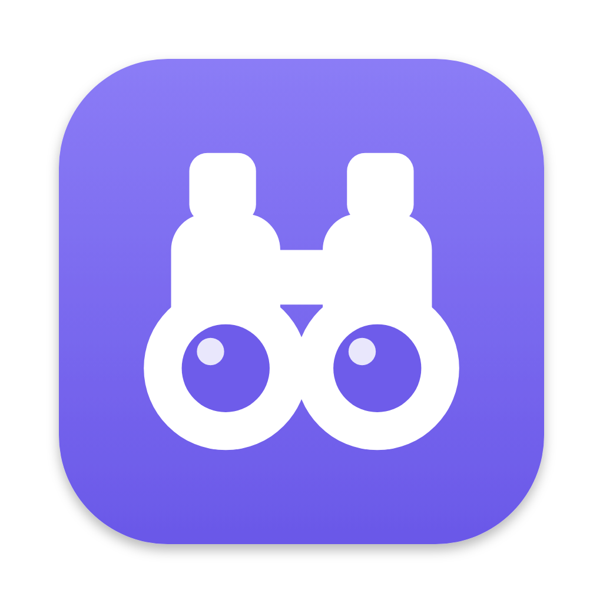
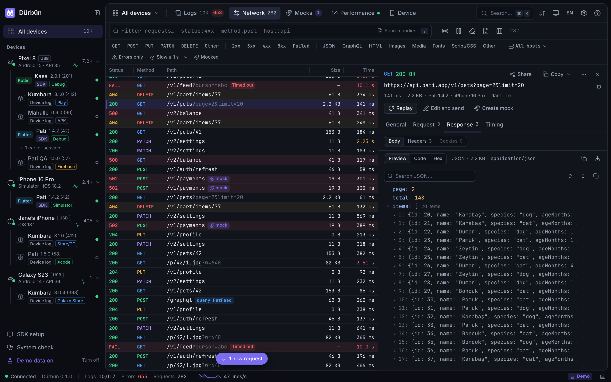
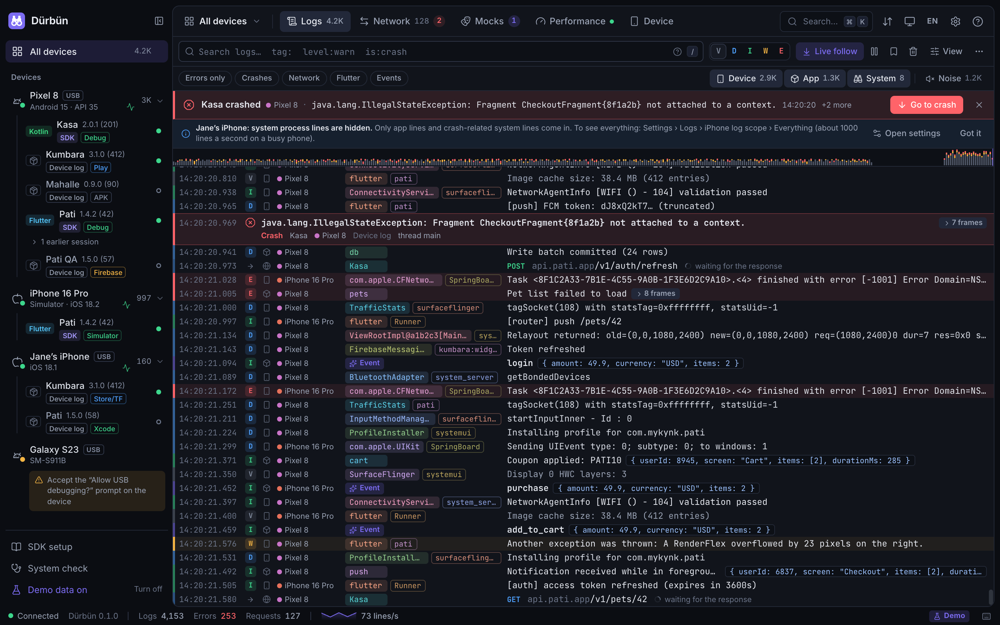

<p align="center">
  
</p>

<h1 align="center">Dürbün</h1>

<p align="center">
  Android ve iOS uygulamaları için Mac'te canlı log, ağ trafiği ve performans.
</p>

<p align="center">
  <a href="https://github.com/mykynk/durbun/actions/workflows/ci.yml"></a>
  <a href="https://pub.dev/packages/durbun"></a>
  <a href="LICENSE"></a>
</p>

<p align="center">
  <a href="README.md">English</a> · Türkçe
</p>



Android veya iOS cihazı takın ya da simülatör/emülatör açın: Dürbün uygulamanın yaptığı her şeyi tek, okunaklı
ve canlı bir pencerede gösterir.

- **Loglar.** Android logcat, iOS cihaz ve simülatör logları, uygulamanın kendi logları, hatalar, çökmeler ve
  event'ler. Çok satırlı çıktılar, stack trace'ler ve JSON katlanır; aynı satırlar ×N olarak birleşir;
  çökmeler göze batar.
- **Ağ.** Her HTTP(S) isteği başlıkları, gövdeleri ve zamanlamalarıyla. cURL, fetch, Dio, Swift veya OkHttp
  olarak kopyalama, yeniden ya da düzenleyip gönderme, iki isteği karşılaştırma, HAR olarak dışa aktarma.
- **Mock'lar.** Eşleşen isteklere hazır yanıt verme, gecikme ekleme veya hata simüle etme. Kuralları SDK
  uygulamanın içinde uygular; proxy ya da sertifika gerekmez.
- **Performans.** CPU, bellek, heap, FPS ve takılmalar, saniyede istek ve saniyede log.
- **Cihaz araçları.** Ekran görüntüsü ve ekran kaydı, deep link, uygulama başlatma, durdurma, kurma ve
  kaldırma, koyu mod, yazı boyutu, konum, simülatöre push bildirimi, durum çubuğu ve uygulamanın kendi
  eklediği butonlar.

Cihaz logları SDK olmadan da gelir. SDK'sı olmayan Flutter debug uygulamalarına Dürbün Dart VM Service
üzerinden kendiliğinden bağlanır. Uygulama logları, ağ yakalama, ölçümler ve mock'lar için SDK eklenir.

Arayüz İngilizce ve Türkçedir, sistem dilini izler.



## Kurulum

### Mac uygulaması

Mac'inize uygun DMG'yi [GitHub Releases](https://github.com/mykynk/durbun/releases/latest) sayfasından
indirin: Apple silicon için `Durbun-<sürüm>-arm64.dmg`, Intel için `Durbun-<sürüm>-x64.dmg`. Açıp Dürbün'ü
Uygulamalar klasörüne sürükleyin. macOS 13 Ventura veya üstü gerekir.

Yayın paketleri henüz Apple noter onayından geçmediği için macOS ilk açılışta bir kez sorar: Finder'da
Dürbün'e sağ tıklayın → **Aç** → **Aç**. macOS bu seçeneği göstermezse Sistem Ayarları → Gizlilik ve
Güvenlik'te Dürbün'ün yanındaki **Yine de Aç**'a tıklayın.

Dürbün kendiliğinden güncelleme aramaz. **Dürbün → Güncellemeleri Denetle…** yeni bir sürüm varsa indirme
sayfasını açar.

### Gereksinimler

| Ne için | Gereken |
|---|---|
| Mac uygulaması | macOS 13 veya üstü (Node.js içinde gelir) |
| Komut satırı (`npm start`) | Node.js 20 veya üstü |
| Android cihaz ve emülatör | `adb` (Android SDK Platform-Tools) |
| iOS simülatör | Xcode (`xcrun simctl`) |
| iOS fiziksel cihaz | Xcode ve `idevicesyslog` (`brew install libimobiledevice`; Flutter önbelleğindeki kopya da olur) |

Uygulamadaki **Sistem kontrolü** ekranı eksik olanı ve nasıl tamamlanacağını söyler.

### Cihazsız denemek

```bash
git clone https://github.com/mykynk/durbun.git && cd durbun
npm install
npm run demo
```

Demo; sanal cihazlar, uygulamalar, loglar ve ağ trafiğiyle açılır.

## Uygulamaya SDK ekleme

Uygulamadaki **SDK kurulumu** ekranı aynı adımları kopyalanabilir haliyle gösterir.

| Platform | Kurulum | Kılavuz |
|---|---|---|
| Flutter | pub.dev'de [`durbun`](https://pub.dev/packages/durbun); Dio'nun native adaptörleri için [`durbun_dio`](https://pub.dev/packages/durbun_dio) | [sdks/flutter/durbun](sdks/flutter/durbun/README.md) |
| iOS (Swift, URLSession) | Swift Package Manager: `0.1.0` sürümünden itibaren `https://github.com/mykynk/durbun`; CocoaPods `v0.1.0` etiketinden | [sdks/ios](sdks/ios/README.md) |
| Android (Kotlin, OkHttp) | Gradle, bu depodan (`io.github.mykynk:durbun`; Maven Central yayını bekliyor) | [sdks/android](sdks/android/README.md) |
| React Native / JavaScript | Bu depodan paketlenmiş tarball (`@durbun/react-native`; henüz npm'de değil) | [sdks/js](sdks/js/README.md) |

SDK'lar release derlemelerinde siz açmadıkça kapalıdır; nasıl açılacağı her kılavuzda yazar. Bağlantıyı
kendileri kurar: Android'de `adb reverse`, iOS cihazda usbmux, simülatörde `127.0.0.1:9751`. LAN
bağlantılarına izin verirseniz Wi-Fi üzerinden de çalışır.

## Gizlilik

- Dürbün kendiliğinden Mac'in dışına hiçbir şey göndermez: analitik, telemetri ya da otomatik güncelleme
  denetimi yoktur. Çökme dökümleri Mac'te kalır.
- Mac'ten dışarı istek yalnızca siz istediğinizde çıkar: **Güncellemeleri Denetle** (GitHub API'ye tek
  istek) ve yakalanmış bir isteği yeniden göndermek (isteğin kendi adresine).
- Sunucu yalnızca `127.0.0.1`'i dinler. Aynı ağdaki cihazların SDK portuna bağlanması için Ayarlar'da
  **LAN**'ı açın (ya da `--lan` verin).
- SDK'lar yakaladıklarını yalnızca Mac'inizdeki Dürbün'e gönderir.

## Mac uygulaması ayrıntıları

<details>
<summary>Portlar, pencere, kabuk ortamı, kapatma ve tanılama</summary>

- Dürbün sunucuyu uygulamanın içinde çalıştırır ve arayüzü kendi penceresinde açar; terminal gerekmez.
- Port 9750 (arayüz) ve 9751 (SDK'lar). Bir Dürbün zaten çalışıyorsa (ör. `npm start`) uygulama onu açar, o
  kapanınca kendi sunucusunu başlatır; sürümler farklıysa menü çubuğundaki simge söyler. Pencere yalnızca
  Dürbün olduğunu kanıtlayan bir sunucuya bağlanır (`/api/health` adı ve sürümü, `/` adresinde Dürbün
  arayüzü). Port başka bir programdaysa 9760, 9770 ve 9780'i dener ve kullandığı portu menü çubuğunda
  gösterir.
- Pencere sunucuyu `localhost` yerine `http://127.0.0.1:<port>` adresinden açar; `localhost` önce `::1`'i
  dener ve orada başka bir program olabilir.
- Menüler ve menü çubuğu uyarıları arayüzün dilini (ilk açılışta sistem dilini) izler. Sunucunun İngilizce
  metni tanılama günlüğüne yazılır.
- Sunucu ve arayüz `app.asar` içindedir; Electron'un bütünlük denetimi değiştirilmiş bir kopyayı
  çalıştırmaz.
- Dürbün `PATH`'i ve araç ayarlarını (`ANDROID_HOME`, `JAVA_HOME`, fvm, `DEVELOPER_DIR`) giriş kabuğunuzdan
  okur; `adb`, `flutter` ve `idevicesyslog` Terminal'deki gibi bulunur. Kabuk 3 saniyede yanıt vermezse
  menü çubuğundaki simge söyler.
- Pencereyi kapatmak yakalamayı durdurmaz; Dürbün menü çubuğunda çalışmaya devam eder. ⌘Q ya da menü
  çubuğu simgesi → **Çık** sunucuyu düzgünce durdurarak kapatır.
- Sunucu başlayamazsa pencere nedenini gösterir ve **Tekrar Dene**, **Tanılama Günlüğünü Göster** ve
  **Çık** seçeneklerini sunar. Yardım → **Sorun Bildir…** yeni bir GitHub issue'su açar; Yardım →
  **Lisanslar** üçüncü taraf lisanslarını listeler.

</details>

## Komut satırı

```bash
npm install
npm run build
npm start
```

Arayüz http://localhost:9750 adresinde açılır; Chrome, Brave, Edge, Arc veya Chromium kuruluysa adres
çubuğu olmayan bir uygulama penceresinde.

```
node dist/durbun.mjs [--port 9750] [--sdk-port 9751] [--demo] [--no-open] [--lan]
                     [--data-dir ~/.durbun] [--ui-dir YOL] [--verbose]
```

Ayarlar ve mock kuralları `~/.durbun` içinde saklanır.

## Mac uygulamasını derlemek

```bash
npm install
npm run app:dist
```

`apps/desktop/release/` içinde `Durbun-<sürüm>-arm64.dmg` ve `mac-arm64/Dürbün.app` oluşur (bu Mac için,
ad-hoc imzalı). `npm run app:release` Apple silicon ve Intel için DMG ve ZIP üretir. `CSC_NAME` (ya da
`CSC_LINK` + `CSC_KEY_PASSWORD`) bir "Developer ID Application" sertifikasını gösteriyorsa uygulama hardened
runtime ile imzalanır; `APPLE_API_KEY` + `APPLE_API_KEY_ID` + `APPLE_API_ISSUER` (ya da `APPLE_ID` +
`APPLE_APP_SPECIFIC_PASSWORD` + `APPLE_TEAM_ID`) da varsa noter onayına gönderilir.

`npm run app` uygulamayı depodaki `dist/` ile çalıştırır. İkinci bir kopya ya da test için: `DURBUN_PORT`,
`DURBUN_SDK_PORT`, `DURBUN_DATA_DIR` (varsayılan `~/.durbun`), `DURBUN_USER_DATA_DIR` (pencere durumu,
tek kopya kilidi ve günlükler), `DURBUN_DEMO=1`, `DURBUN_DEBUG=1`.

## Kaldırma

1. Dürbün'ü kapatın (⌘Q) ve Uygulamalar klasöründen Çöp Sepeti'ne taşıyın.
2. Verilerini de silmek için:
   - `~/.durbun`: ayarlar (`settings.json`), mock kuralları (`mocks.json`) ve geçici dosyalar.
   - `~/Library/Application Support/Dürbün`: pencere durumu, arayüz tercihleri, tanılama günlüğü ve çökme
     dökümleri.
3. Uygulamalarınıza eklediğiniz SDK paketlerini kaldırın.

## Geliştirme

```bash
npm run dev          # sunucu kaynaktan (değişince yeniden başlar) + Vite, http://localhost:5173
npm run typecheck
npm test
npm run app:test     # Mac uygulaması
```

| Klasör | İçerik |
|---|---|
| `packages/protocol` | Sunucu, arayüz ve SDK'ların paylaştığı veri tipleri ve komutlar |
| `packages/server` | Cihaz sürücüleri (adb, simctl, devicectl, idevicesyslog), SDK bağlantıları, Dart VM Service köprüsü, HTTP/WebSocket API, demo, CLI |
| `packages/ui` | React arayüzü: Loglar, Ağ, Mock'lar, Performans, Cihaz ([yapı](packages/ui/src/README-ui.md)) |
| `apps/desktop` | Mac uygulaması (Electron) |
| `sdks/*` | Flutter, Android, iOS ve React Native SDK'ları |
| `SPEC.md` | Ürün ve mühendislik şartnamesi |

Pull request açmadan önce [CONTRIBUTING.md](CONTRIBUTING.md)'yi, güvenlik açığı bildirmek için
[SECURITY.md](SECURITY.md)'yi okuyun.

## Sürümleme

Dürbün [Semantic Versioning](https://semver.org) kullanır. Mac uygulaması, sunucu ve tüm SDK'lar aynı
sürümü taşır ve `main` üzerindeki bir `vX.Y.Z` etiketinden birlikte yayımlanır; değişiklikler
[CHANGELOG.md](CHANGELOG.md)'de. Sürüm `0.x` iken ara sürümler uyumsuz değişiklik içerebilir.

## Lisans

[MIT](LICENSE) © 2026 Muhammed Yusuf Kaynak
