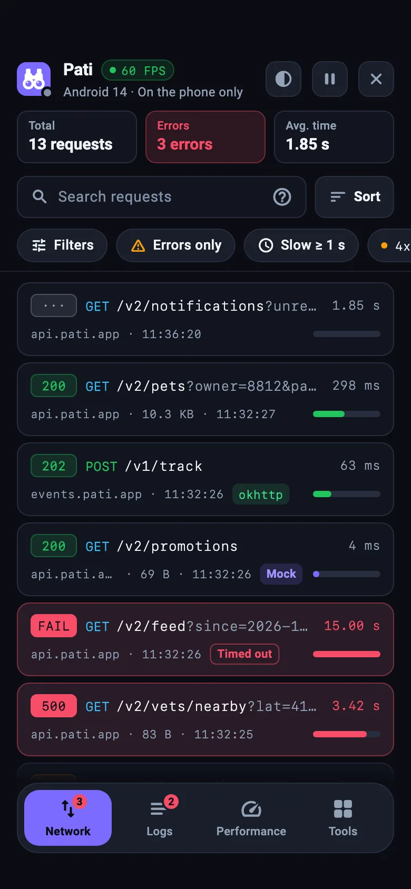
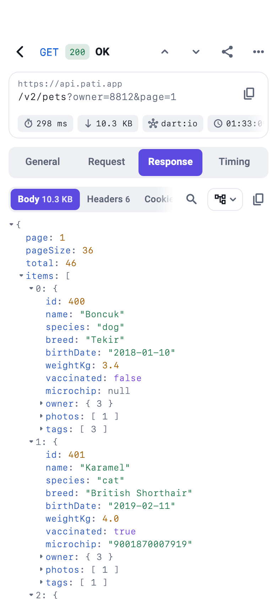
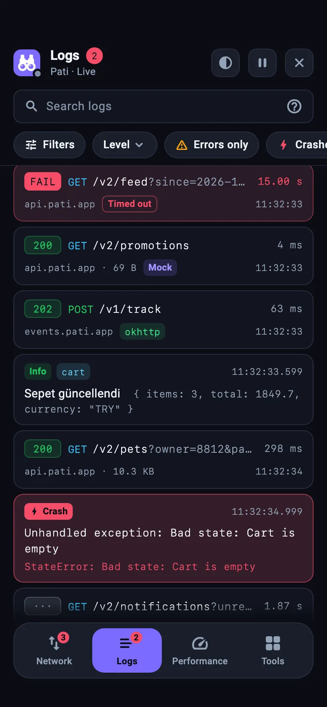

# Dürbün for Flutter (`durbun`)

## What you get

Dürbün is a Mac app that shows **all logs, errors and network traffic** of
an app in one live view while the device is plugged into your Mac (or the app
runs in a simulator or emulator). This package sends the data from inside the
app. It is a **Flutter plugin**: besides the Dart SDK it carries the native
Android (Kotlin) and iOS (Swift) layers, so a single install covers Flutter and
native code. You do not need a separate SDK per layer.

The Mac app and the SDKs for other platforms live in the
[Dürbün repository](https://github.com/mykynk/durbun#readme).

The package also ships an [in-app panel](#in-app-panel), so you can read
everything on the phone itself, with or without a Mac. The panel is available
in English and Turkish and follows the app's (or the phone's) language.

<p>
  
  
  
</p>

- [What you get](#what-you-get)
- [Install](#install)
- [Start](#start)
- [Connect to the Mac](#connect-to-the-mac)
- [What is captured](#what-is-captured)
- [Mocks](#mocks)
- [Tools](#tools)
- [In-app panel](#in-app-panel)
- [Release builds and safety](#release-builds-and-safety)
- [Options](#options)
- [Troubleshooting](#troubleshooting)
- [Development](#development)

## Install

```bash
flutter pub add durbun
```

or in `pubspec.yaml`:

```yaml
dependencies:
  durbun: ^0.2.0
```

After adding or updating the SDK, run `cd ios && pod install` once on iOS
(CocoaPods must refresh the project when files are added to the plugin).
Upgrading: [Versions and upgrades](https://github.com/mykynk/durbun/blob/main/docs/guides/versions.md).
To use the latest unreleased code, see
[Unreleased changes from a clone](#unreleased-changes-from-a-clone).

## Start

Wrap `main` in `Durbun.run`:

```dart
import 'package:durbun/durbun.dart';
import 'package:flutter/material.dart';

Future<void> main() async {
  await Durbun.run(() async {
    WidgetsFlutterBinding.ensureInitialized(); // call it inside the zone
    runApp(const MyApp());
  });
}
```

That is all. There is no native initialization code: when the Dart side runs, it
starts the Android and iOS layers itself, and when it is off, they stay off. A
native `Durbun.start()` call is not needed. If one is left in your code, it does
nothing in a Flutter app (it detects the plugin and leaves the work to the Dart
side). This way no separate native session is opened, and `DURBUN=false` keeps
the native layer off as well.

`Durbun.run` opens a zone, so it also captures `print` output and uncaught
errors. If you do not want a zone:

```dart
Future<void> main() async {
  await Durbun.init();
  runApp(const MyApp());
}
```

In that case only `debugPrint` is captured, and zone errors arrive through
`PlatformDispatcher.onError`. If you have your own `HttpOverrides.global`, assign
it **before** `Durbun.init()`: an override assigned later is chained within
about 2 seconds, and `HttpClient`s created in the meantime (for example the one
Dio caches on its first request) are not captured. Inside `Durbun.run` there is
no such gap: every `HttpClient` created in the zone asks the current global
override and is wrapped.

If `ensureInitialized()` was called **outside** the zone (for example before
`Durbun.run`, to run `await Firebase.initializeApp()`), `Durbun.run` does not
open a zone, to avoid Flutter's "Zone mismatch" error. It then behaves like
`init`: `print` is not captured (only `debugPrint`), and a note is printed to the
console once. To capture `print` as well, move everything, Firebase included,
into the body:

```dart
Future<void> main() async {
  await Durbun.run(() async {
    WidgetsFlutterBinding.ensureInitialized();
    await Firebase.initializeApp();
    runApp(const MyApp());
  });
}
```

### Android: native OkHttp (optional)

One line on Android if your native code uses OkHttp:

```kotlin
import dev.durbun.DurbunInterceptor

val client = OkHttpClient.Builder()
    .addInterceptor(DurbunInterceptor())   // <- this line
    .build()
```

While Dürbün is off (release builds), this interceptor passes requests through
untouched. On iOS, URLSession traffic (the shared session, your own sessions,
Alamofire, cupertino_http) is captured **automatically**; no extra line is
needed.

### Pure Dart (without Flutter)

`package:durbun/durbun_core.dart` (`DurbunClient.start(...)`) works as is in Dart
programs without Flutter; the plugin's native side is not involved for them.

## Connect to the Mac

- **Android (USB or emulator):** no setup. The Mac app runs
  `adb reverse tcp:9751` and the SDK connects to `127.0.0.1:9751` (on emulators,
  `10.0.2.2` is the fallback).
- **iOS physical device (USB):** no setup. The SDK listens on one of the device's
  `127.0.0.1:9752–9755` ports, and the Mac app connects through usbmux.
- **iOS simulator:** no setup (the simulator uses the Mac's `127.0.0.1`).
- **Wi-Fi:** give the app the Mac's IP address in one of the
  [ways below](#giving-the-app-the-macs-address).
  In the Mac app, turn on Settings → Connection → "Allow local network (Wi-Fi)
  connections" (when you run the server from the repository instead, start it
  with `node dist/durbun.mjs --lan`). On iOS 14+, add a local
  network usage description to `ios/Runner/Info.plist`:

  ```xml
  <key>NSLocalNetworkUsageDescription</key>
  <string>To connect to the Dürbün developer tool</string>
  ```

Connection state is available through `Durbun.isConnected`,
`Durbun.connectionState` and `Durbun.connection` (a stream). If the app does not
show up, see [Not connecting?](#not-connecting).

### Giving the app the Mac's address

- `DurbunOptions(host: '192.168.1.20')` or
  `flutter run --dart-define=DURBUN_HOST=192.168.1.20` (`'ip'` or `'ip:port'`).
- Or type it on the phone in the in-app panel (Tools → Mac connection; no
  rebuild needed): `192.168.1.20` or `192.168.1.20:9751`. It is tried at once,
  kept for the next launches (in the app's cache directory) and used instead of
  the build's address; *Use the build's address* / *Forget
  the address* goes back. The USB link keeps working alongside it.

### While there is no connection

While there is no connection, the SDK buffers the last 5,000 messages, retries
with a backoff from 0.5 s to 3 s, and sends the buffered messages in order once
connected. After two minutes without the Mac app the attempts slow down to about
one every 30 seconds, and while the app is in the background none are made, so
a test phone that is never plugged in does not keep waking up. Coming back to
the app, typing an address under Tools → Mac connection (or tapping Connect
again) tries at once; on iOS devices the USB listener answers the Mac app at
any time. On Android over USB, the Mac app is found at the next attempt (at
most about 30 s, at once when you return to the app) (a warning line reports how many overflowed). If the Mac app has never
connected, or has not been present for more than 30 seconds, the waiting
messages take up at most about 8 MB: past that, the oldest bodies are dropped
(request rows and logs stay, and the body is shown as truncated). The in-app
panel keeps its own copy and is not affected.

Without the Mac app, requests do not wait. They wait for at most 0.8 s only when
the Mac app has accepted the connection and the handshake is still in progress
(mock rules are on their way).

## What is captured

### Where the data comes from

Everything leaves the app over **one connection** and appears in the Mac app as
a single app session (with an "SDK" badge). No proxy is involved, so SSL pinning
is left untouched.

| Source | What it sends | When |
|---|---|---|
| Dart SDK (this package) | Dart logs, `print`, Flutter errors, Dart crashes, dart:io HTTP (package:http, Dio's default adapter, `NetworkImage`), FPS/jank/memory, `flutter.*` tools | While Dürbün is on |
| Android native layer (in this plugin) | Kotlin/Java `Durbun.log`, uncaught Kotlin/Java crashes, OkHttp (with `DurbunInterceptor`), the app's own logcat (`Log.d` and so on; always in the panel, in the Mac app only when adb is not available, for example over Wi-Fi), `android.*` tools | Once the Dart side starts it |
| iOS native layer (in this plugin) | URLSession traffic (automatic), Objective-C exceptions and Swift crashes, Swift `print`/stdout/stderr, `Durbun.log` (Swift), iOS 15+ `os_log` / `Logger` / `NSLog` (always in the panel, in the Mac app only when it cannot read device logs, for example over Wi-Fi), `ios.*` tools | Once the Dart side starts it |
| Without the SDK (old builds, release builds with Dürbün off) | Device logs, system crash records, Android process and frame statistics; the Mac app reads these from the device | Always |

What the Dart side captures:

| Source | How | In the Mac app |
|---|---|---|
| `Durbun.log/v/d/i/w/e/f` | Directly | Level, tag, `data` (JSON), error and stack trace |
| `print` / `debugPrint` | The zone (`run`) or a `debugPrint` hook (`init`) | An info log with the `flutter` tag, **only** when the Mac app cannot see device logs (`capturePrint: auto`), so lines are not shown twice |
| `FlutterError.onError` | Chained, preserving the previous handler | `flutter-error`: the whole error box (`══╡ EXCEPTION CAUGHT BY …`) |
| Uncaught errors | Zone and `PlatformDispatcher.onError` | `crash` (fatal), with a stack trace; the error is also forwarded to the previous handler |
| HTTP (dart:io) | An `HttpOverrides.global` wrapper (a previous override is chained) | Request and response, headers, bodies (gzip decoded), timings, redirects (one entry per hop, as with URLSession), cancellations and errors. Includes `package:http`, Dio's default adapter and `NetworkImage`. WebSocket messages and Server-Sent Events too (see [WebSockets and Server-Sent Events](#websockets-and-server-sent-events)) |
| Events | `Durbun.event` | An event line in the log stream |
| Metrics | `SchedulerBinding.addTimingsCallback`, `ProcessInfo.currentRss`, `getrusage` | FPS (while rendering), janky frames, average build/raster ms, memory MB, CPU %, threads (Android) |

### Network

- On Android, **cronet_http / Dio's `NativeAdapter`** use neither dart:io nor
  OkHttp. For Dio, wrap the adapter with `DurbunDioAdapter` from the
  [`durbun_dio`](https://pub.dev/packages/durbun_dio) package
  (`dio.httpClientAdapter = DurbunDioAdapter(NativeAdapter())`); the older
  `DurbunDioInterceptor(dio: dio)`, added as the **last** interceptor, still
  works. On iOS these run on URLSession and are captured by the native layer
  (`durbun_dio` does not report those requests a second time).
- **Not captured:** on Android, package:http's `CronetClient` and
  `package:ok_http` (it builds its own OkHttp client, so `DurbunInterceptor`
  cannot be added); on every platform, gRPC (`package:grpc` speaks HTTP/2 over
  its own sockets) and code that uses `Socket` directly. You can report these
  yourself with `DurbunNetwork.begin` (see
  [Reporting other clients yourself](#reporting-other-clients-yourself)).
- For redirects that dart:io follows by itself, only the status code and the
  `location` header of the intermediate hops are known; mock rules do not apply
  to intermediate hops.
- `HttpClient`s created **before** `Durbun.run/init` are not wrapped.
- `redactHeaders` masks header values as `••••` in every layer (Dart, OkHttp,
  URLSession).

#### WebSockets and Server-Sent Events

A WebSocket connection or a Server-Sent Events response is one network entry:
the handshake (`101`) or the response headers, then its messages in order
under the same entry. Messages are sent only while the Mac app asks for them;
otherwise the entry looks as it always did (a `101`, or an event stream with
its body when it ends).

The [in-app panel](#in-app-panel) keeps its own copy of the messages, apart
from what goes to the Mac: connections opened through dart:io and
`DurbunNetwork.webSocket` show their messages on the phone whether or not the
Mac app records them. Native clients (OkHttp, URLSession),
`call.eventStream` and background isolates reach the panel only while the Mac
app records messages. The panel keeps at most 500 messages per connection
(the first 20 stay, then the newest), the first 16 KB of each payload (the
size shown is always the full one; sizes only while bodies are off), and
8 MB or 5,000 messages across all connections, removing the oldest finished
connection's messages first. The list marks where messages were removed and
how many.

- **Automatic (dart:io):** `WebSocket.connect`, `IOWebSocketChannel` and
  `WebSocketChannel.connect` on Android and iOS, and every `text/event-stream`
  response read through `HttpClient`, `package:http` or Dio's default adapter.
  Dürbün reads a copy of the bytes; your app's connection is not changed.
- **WebSocket messages:** direction, text or binary, size, close code and
  reason, ping and pong. Content is kept up to the Mac app's message limit
  (64 KB at most) and only while bodies are captured; otherwise sizes only.
  Compressed messages (`permessage-deflate`) are shown decoded. A compressed
  message that refers to one Dürbün did not follow (the Mac app started
  asking in the middle of a connection) shows its compressed size and no
  content.
- **Events:** the event type (when it is not `message`), `id`, `retry`, size
  and data. A stream the server ends is closed in the list; one your app stops
  reading shows as cancelled.
- A connection that breaks shows the error. A connection that started sending
  messages always gets its end, even if the Mac app stops asking in the
  meantime.
- Event streams sent compressed (`content-encoding: gzip`) are reported the
  classic way, with the body when it ends.
- dart:io opens every `WebSocket.connect` with one shared `HttpClient`, created
  at the first connection. If your app's first WebSocket opens **before**
  `Durbun.run/init`, later ones are not captured either; pass
  `customClient: HttpClient()` to `WebSocket.connect` to fix that.
- Other stacks (`CupertinoWebSocket`, WebSockets on `package:ok_http`, event
  streams read through `DurbunNetwork.begin`) report through a handle. Do not
  wrap a dart:io WebSocket: it is already captured and would show twice.

```dart
final ws = DurbunNetwork.webSocket(uri, protocols: ['chat.v2']);
final stream = ws?.incoming(channel.stream,
        closeInfo: () => (channel.closeCode, channel.closeReason)) ??
    channel.stream;
final sink = ws?.outgoing(channel.sink) ?? channel.sink;
await channel.ready;
ws?.opened(protocol: channel.protocol);
```

For an event stream, call `call.eventStream(status: ..., headers: ...)` on the
handle `DurbunNetwork.begin` returned. It reports the headers at once and
returns a handle whose `tap(stream)` reports each event as your app reads it;
it returns null while the Mac app does not ask for messages, so report the
response with `call.response(...)` as usual then. The wrapper below does both.

#### Reporting other clients yourself

For package:http clients (for example `CronetClient`, `OkHttpClient`), copy
this wrapper into your app and wrap the client once:
`DurbunReportingClient(CronetClient.fromCronetEngine(engine))`. While Dürbün
is off, `begin` returns null and requests go straight to the inner client.
The response still streams to your code chunk by chunk (downloads and
server-sent events keep working); only the first `DurbunNetwork.maxBodyBytes`
bytes are copied for the report, which is sent when the body ends, fails or
your code stops reading it. The plugin does not ship this class, so it does
not add `package:http` to your dependencies; the package's tests run this
exact code.

```dart
import 'dart:async';
import 'dart:typed_data';

import 'package:durbun/durbun.dart';
import 'package:http/http.dart' as http;

/// Reports the requests of any package:http client (CronetClient,
/// OkHttpClient, …) to Dürbün. The response still streams to your code
/// chunk by chunk; only its first DurbunNetwork.maxBodyBytes bytes are copied
/// for the report, which is sent when the body ends, fails or is cancelled.
/// Server-Sent Events are reported one event at a time while the Mac app
/// asks for them.
class DurbunReportingClient extends http.BaseClient {
  DurbunReportingClient(this._inner, {this.source = 'cronet'});

  final http.Client _inner;
  final String source;

  @override
  Future<http.StreamedResponse> send(http.BaseRequest request) async {
    final call = DurbunNetwork.begin(
      method: request.method,
      url: request.url,
      headers: [for (final h in request.headers.entries) [h.key, h.value]],
      body: request is http.Request ? request.bodyBytes : null,
      contentType: request.headers['content-type'],
      source: source,
    );
    if (call == null) return _inner.send(request); // Dürbün is off
    final http.StreamedResponse response;
    try {
      response = await _inner.send(request);
    } catch (e) {
      call.error(e);
      rethrow;
    }
    final headers = [for (final h in response.headers.entries) [h.key, h.value]];
    final events = (response.headers['content-type'] ?? '').startsWith('text/event-stream')
        ? call.eventStream(status: response.statusCode, statusText: response.reasonPhrase, headers: headers)
        : null;
    if (events != null) return _withBody(response, events.tap(response.stream));

    final limit = DurbunNetwork.captureBodies ? DurbunNetwork.maxBodyBytes : 0;
    final copy = BytesBuilder(copy: false);
    var size = 0;
    var ended = false;
    void end([Object? error, bool cancelled = false]) {
      if (ended) return;
      ended = true;
      if (error != null) {
        call.error(error, cancelled: cancelled);
        return;
      }
      call.response(
        status: response.statusCode,
        statusText: response.reasonPhrase,
        headers: headers,
        body: copy.takeBytes(),
        bodySize: size,
        contentType: response.headers['content-type'],
      );
    }

    final body = StreamController<List<int>>(sync: true);
    body.onListen = () {
      final sub = response.stream.listen(
        (chunk) {
          if (size < limit) {
            copy.add(chunk.length <= limit - size ? chunk : chunk.sublist(0, limit - size));
          }
          size += chunk.length;
          body.add(chunk);
        },
        onError: (Object e, StackTrace st) {
          end(e);
          body.addError(e, st);
        },
        onDone: () {
          end();
          body.close();
        },
      );
      body
        ..onPause = sub.pause
        ..onResume = sub.resume
        ..onCancel = () {
          end('cancelled', true);
          return sub.cancel();
        };
    };
    return _withBody(response, body.stream);
  }

  http.StreamedResponse _withBody(http.StreamedResponse response, Stream<List<int>> body) {
    return http.StreamedResponse(
      body,
      response.statusCode,
      contentLength: response.contentLength,
      request: response.request,
      headers: response.headers,
      isRedirect: response.isRedirect,
      persistentConnection: response.persistentConnection,
      reasonPhrase: response.reasonPhrase,
    );
  }

  @override
  void close() => _inner.close();
}
```

For gRPC and other protocols, make the same `DurbunNetwork.begin` →
`call.response(...)` / `call.error(...)` calls in your own layer.

### Logs and events

```dart
Durbun.log('User signed in', tag: 'auth', data: {'userId': 42});
Durbun.d('Cache warmed up');            // v / d / i / w / e / f
Durbun.e('Payment failed', error: e, stackTrace: st);
Durbun.i({'cart': [1, 2, 3]});          // Map/List -> JSON (a tree on the desktop)
Durbun.event('purchase', {'amount': 49.9});
```

Logging from native code:

```kotlin
import dev.durbun.Durbun
Durbun.i("payment", "3DS completed", data = mapOf("orderId" to 42))
```

```swift
import durbun
Durbun.info("3DS completed", tag: "payment", data: ["orderId": 42])
```

- `dart:developer` `log()` calls come not from the SDK but from the Mac app's Dart
  VM Service connection (debug builds, USB or simulator). Dart has no hook for
  them inside the app: they never reach the panel, a Wi-Fi-only Mac app or a
  release build. Reading them in the app would mean connecting to the app's own
  VM Service, which would stop `flutter run` / `flutter attach` from starting
  its debugger connection, so the SDK does not do it. Use `Durbun.log`, `print`
  or `debugPrint` for lines you need on the phone.
- iOS `os_log` / `Logger` / `NSLog` lines are read from the app's own log store
  every few seconds (every second while the panel is open or the lines are going
  to the Mac app). iOS does not keep `debug` entries in that store, so those
  lines do not appear in the panel; on iOS 13–14 this source does not exist.
  `com.apple.*` system lines are skipped.

#### Background isolates

`Durbun.log`, `Durbun.e`, `Durbun.event` and friends work in any isolate of
the app: in `compute`, `Isolate.run`, `Isolate.spawn` or a background engine
they are sent to the SDK running in the main isolate, and appear in the same
stream, in the Mac app and in the panel. To capture the dart:io HTTP traffic
of a background isolate too (package:http, Dio's default adapter), call
`Durbun.attachIsolate()` once at the start of its work:

```dart
final feed = await Isolate.run(() async {
  await Durbun.attachIsolate(); // true when its requests are captured
  final res = await http.get(Uri.parse('https://api.example.com/feed'));
  Durbun.d('feed parsed', tag: 'sync');
  return parseFeed(res.body);
});
```

The isolate takes the main isolate's body limit, `redactHeaders` and whether
the Mac app asks for WebSocket and event stream messages; mock rules apply
only to the main isolate's requests. When no SDK runs in the main
isolate (Dürbün off in this build, or nothing started it), these calls do
nothing and `attachIsolate()` completes with `false`.

In background isolates (`compute`, `Isolate.run`, `Isolate.spawn`,
workmanager tasks), `print` is not captured, and work that runs while the
app's main isolate is not running (for example a push handler in a fresh
background engine) is not seen.

#### Screens and app lifecycle

Add `DurbunNavigatorObserver` to your navigator and each screen change is sent
as a `navigation` event (`{from, to}`, route names only; arguments are never
sent), the same event the other Dürbün SDKs send, so logs and requests can be
read next to the screen they happened on:

```dart
final screens = DurbunNavigatorObserver(); // one instance, not one per build

MaterialApp(
  navigatorObservers: [screens],
  builder: DurbunInspector.builder,
);
// With go_router, give it to the router instead:
GoRouter(observers: [screens], routes: [...]);
```

Only pages count (dialogs and bottom sheets do not change the screen), and only
pages with a name: use named routes, `RouteSettings(name: ...)`, or
`DurbunNavigatorObserver(routeName: (route) => ...)`. One observer serves one
navigator; give each nested navigator (go_router `ShellRoute`) its own. The
panel's own `/durbun` route is never reported.

Each time the app goes to the background or comes back, a log line with the tag
`lifecycle` is sent (`AppLifecycleState.inactive`, `.hidden`, `.paused`,
`.resumed`). `DurbunOptions(captureLifecycle: false)` turns these lines off.

#### If you already use a logging package

Packages that write with `print` are captured already. To keep levels and tags,
forward `package:logging` records directly:

```dart
Logger.root.level = Level.ALL;
Logger.root.onRecord.listen((r) => Durbun.log(
  r.message,
  tag: r.loggerName,
  error: r.error,
  stackTrace: r.stackTrace,
  level: r.level >= Level.SHOUT ? DurbunLogLevel.fatal
       : r.level >= Level.SEVERE ? DurbunLogLevel.error
       : r.level >= Level.WARNING ? DurbunLogLevel.warn
       : r.level >= Level.INFO ? DurbunLogLevel.info
       : r.level >= Level.FINE ? DurbunLogLevel.debug
       : DurbunLogLevel.verbose,
));
```

### Crashes

Flutter errors (`FlutterError.onError`) and uncaught Dart errors arrive as
shown in the table above; `captureErrors: false` turns them off, native crashes
included.

Native crashes: on Android, a crash goes straight to the Mac app at crash time;
if the Mac app cannot be reached at that moment, it arrives on the next launch
as **"Previous launch crashed — …"**. On iOS, exceptions off the main thread
arrive immediately; main-thread exceptions and signal crashes (force unwrap,
EXC_BAD_ACCESS) arrive on the next launch as **"Crash in previous launch: …"**.

Stack traces of `--split-debug-info` builds: see
[Which builds run Dürbün](#which-builds-run-dürbün).

### Performance

FPS (while rendering), janky frames, average build/raster time, memory, and CPU
and threads where the platform reports them. FPS is reported only while frames
are drawn (an idle app does not show "0 FPS"). `metrics: false` turns them off.

### Platforms and engines

- On desktop platforms (macOS, Windows, Linux) there is no native layer; the
  Dart side (dart:io HTTP, logs, errors, metrics) works. A sandboxed macOS app
  needs the `com.apple.security.network.client` entitlement to open outgoing
  connections, the one to the Mac app included.
- On the web nothing is captured and the panel does not open (it shows a page
  that says so); every API stays safe to call.
- Hot restart: the native layer restarts with a new session.
- If a process has more than one Flutter engine, only the engine that starts the
  native layer first uses it.
- Native-only (non-Flutter) apps use the SDKs in `sdks/android` and `sdks/ios`.
  Do not add them to a Flutter app as well (the classes would clash).

## Mocks

Mock rules (the **Mocks** tab in the Mac app;
[writing mock rules](https://github.com/mykynk/durbun/blob/main/docs/guides/mocks.md)):
`respond` returns a synthesized
response without touching the network (the response carries an `x-durbun-mock`
header); `delay` waits and then makes the real request; `fail` produces the
platform's natural error (`SocketException` "Connection refused" / "Failed host
lookup", `HandshakeException`, "timed out"; Dio recognizes the latter as
`connectionTimeout`).

- The rules apply in every layer: Dart, OkHttp (with `DurbunInterceptor`) and
  URLSession. In background isolates they apply only to the main isolate's
  requests; redirect hops that dart:io follows by itself are not mocked.
- Requests made at launch, before the Mac app has connected, go to the real
  server. `DurbunOptions(waitForDesktop: ...)` makes `run` wait before starting
  the app, so mocks apply to them.
- When a connection drops, the mock rules that connection sent are dropped at
  once in every layer (Dart, OkHttp, URLSession); the Mac app sends them again
  when it reconnects. Requests made while there is no connection go to the real
  server.
- In the in-app panel, Tools → Mocks lists the rules and how many times each was
  applied.

## Tools

Built in, in the Mac app's Device tab under App tools: `flutter.debugPaint`,
`repaintRainbow`, `slowAnimations`, `performanceOverlay`,
`invertOversizedImages`, `brightness`, `platform`, `dumpWidgetTree`,
`dumpRenderTree`, plus the native layers' `android.*` and `ios.*` tools.

To add your own tool, register an action (`DurbunAction.button`, `toggle` or
`select`):

```dart
Durbun.addAction(DurbunAction.button(
  id: 'app.clearCache',
  label: 'Clear cache',
  onPressed: (_) async => cache.clear(),
));
```

The same tools are in the in-app panel under Tools → App tools, so a tester
can use them on the phone without the Mac.

## In-app panel

### Open it

To see everything on the phone itself, add one line to `MaterialApp`. The same
line works for `MaterialApp.router` / go_router, `CupertinoApp` and
`WidgetsApp`:

```dart
MaterialApp(
  builder: DurbunInspector.builder,   // <- this line
  home: const HomePage(),
);
```

Nothing is drawn over your app. **Shake the phone** to open the panel (iOS
simulator: *Device → Shake*; Android emulator: *Extended controls → Virtual
sensors → Shake*). The first launch shows a short "Shake the phone to open the
Dürbün panel" hint at the bottom of the screen, once per install
(`DurbunInspector(showHint: false, …)` turns it off). No Mac connection is
required, so a tester can inspect the app on their own phone.

### What the panel shows

The panel has its own look in light and dark: it follows the phone, and the
switch at the top keeps your choice. Four tabs sit at the bottom: **Network**,
**Logs**, **Performance** and **Tools** (on a short screen, such as a phone in
landscape, they move into the header). Tools opens Report a bug, Mac
connection, App tools, Mocks (only while the Mac app is connected), Statistics,
Device & SDK, Export session, Previous run and Clear:

- **Logs:** a live stream (newest at the bottom; it stops following when you
  scroll up and resumes with "↓ N new"), V D I W E level toggles, the quick
  filters *Errors only · Crashes · Network · Events · Flutter · Native*, the
  Mac app's query language (`tag:auth -tag:frame level:warn is:crash`),
  consecutive identical lines merged into `×N`, and request rows inside the
  stream. The detail view shows the message, a collapsible data tree, a stack
  trace that highlights app frames (a stack from a `--split-debug-info` build
  is marked as such, with the `flutter symbolize` command that reads it), "Only this tag" / hide-this-tag actions,
  and **Share**: the line as a report (level, app, device, message, data,
  stack; secret values in the data are masked like a request's) to copy, send through the system share sheet or
  [send to Slack](#send-to-slack).
- **Network:** dart:io, `package:http`, Dio, OkHttp and URLSession in one list
  of cards with status, method, path (query dimmed), start time (`HH:mm:ss`),
  host, source, size, duration (slow requests in yellow or red, with a bar
  against the slowest listed request), GraphQL operation, mock and error labels
  (such as "could not resolve DNS"). On a tall screen, tiles above the list show
  the total, the errors and the average time. It offers method and
  status toggles, the quick filters *Errors only · Slow ≥ 1 s · Mocked*, a host
  picker, queries such as `status:4xx method:post host:api is:slow`, and search
  inside bodies. The detail view has General / Request / Response / Timing
  tabs: a searchable JSON tree for bodies, Code and Hex views, image preview,
  headers, cookies and query parameters, DNS / connect / TLS / TTFB bars, and
  **Replay** and **Copy as** (cURL, fetch, Dart dio, Swift, Kotlin).
  A WebSocket or event stream row says WS or SSE, whether the connection is
  open, closed or broken, and how many messages it has; its detail opens on
  **Messages** (**Events** for SSE): direction (an arrow and a word, not colour
  alone), time since the connection opened, type and size per row, the event
  name, `id` and `retry` for SSE, a search, ping/pong hidden until you switch
  them on, live follow with "↓ N new", and who ended the connection with the
  close code and reason as the last line. A message opens on its own page
  (JSON tree, text or hex) with a masked **Share**.
  **Share** turns a request into a report your team can read without Dürbün
  (URL, status, trace IDs, headers, bodies, cURL; secret values in headers,
  query parameters, JSON and form bodies are masked as `••••` by default, and
  [your own secret names](#secret-names-in-shares-and-exports) can be added) and opens the system share sheet, copies the report or
  [sends it to Slack](#send-to-slack). The Mac app produces the same report. The **Sort** button (next to the search
  box) offers: newest on top (default), arrival order (newest at the bottom, the
  list follows new requests), slowest first, largest response first, and errors
  first. In a sorted list, rows you are reading stay in place while you scroll
  down; new requests wait on top behind "↑ N new".
- **Mocks** (under Tools): the rules that come from the Mac app and how many
  times each was applied. Rules last only as long as the connection, so the
  row appears only while the Mac app is connected.
- **Performance:** the frame rate on top, with a ring against the screen's
  refresh rate and the janky frames; tiles for build/raster time, memory
  (resident memory of the app process, with its peak), and CPU and threads
  where the platform reports them; charts for FPS, frame time and memory. The dashed lines follow the screen's refresh rate (120 FPS and 8.3 ms
  on a 120 Hz phone), the same budget janky frames are counted against. The
  Dart heap is not shown on the phone: reading it needs the Dart VM Service,
  which release builds do not have.
- **Device & SDK** (under Tools): the app, the device, the captured layers
  (Dart / Kotlin / Swift), the Mac app connection, the body setting in use,
  "What is captured?" (whether each data source is on and, if not, why) and
  "What is not captured?" (`print` and HTTP of background isolates that are not attached, `dart:developer` `log()`,
  clients with their own network stack, other native libraries on Android,
  WebView, WebSocket and event stream messages of native clients and background isolates (they reach the panel only while the Mac app records them), clients created before the SDK).
- **Statistics** (under Tools), in scrollable tabs: *Summary* (request count;
  successful, 4xx, 5xx, connection errors (timeouts included) and pending
  requests; methods), *Duration* (average, median (p50), p95, longest), *Data*
  (sizes of the bodies sent and received) and *Hosts* (the 10 hosts that
  received the most requests). Bodies are not decoded, and the page refreshes at
  most once a second. If the Network list is filtered, you can choose between
  *Listed* and *All*.
- **Report a bug** (on Tools, in an error or crash line's detail, and in a
  failed request's ⋯ menu and Share sheet): a tester with only the phone sends what
  just happened in one share. The report is about a moment (the line, the
  request, or the moment the panel opened) and takes the log lines and failed
  requests from 1 minute before it to 10 seconds after (30 s, 2 min or 5 min
  are one tap away), a screenshot of the app taken just before the panel
  opened, the device and app facts and a note. Before anything leaves, the
  screen lists what goes in with counts; the screenshot can be left out, and
  secret values are masked as in Share (in log text too: tokens, cookies,
  passwords, API keys) unless the switch is turned off. One system share sheet
  carries the Markdown text (each failed request on one line, the last 50 log
  lines), the whole report as a `.md` file (up to 500 lines with their stacks
  and data, every failed request in full, cURL for the moment's request) and
  the screenshot as a PNG; if the share sheet cannot open, the report is
  copied. The screenshot is taken only while Dürbün runs, kept in memory only
  while the panel is open and not masked; platform views (maps, web views,
  video) may come out blank. The Mac app is not needed.
- **Export session** (under Tools): the requests in the Network list (with
  filters, search and sort order applied) or all of them, as a **Report (.md)**
  (a summary table plus every request in detail; for Slack, Jira, e-mail) or
  **HAR 1.2** (Chrome DevTools, Charles, Proxyman). Secret values are masked as
  `••••` with the same rules as Share; masking and bodies can each be turned
  off. The file is written in the background to the app's cache folder
  (`durbun-export`) and sent as a file through the system share sheet. Exports
  older than a day are deleted on the next export. If the share sheet cannot be
  opened, an export smaller than 512 KB is copied to the clipboard.
  WebSocket and event stream messages are not part of an export.
- **Previous run** (opt-in, off by default; while off, Tools lists it as *Off*
  and shows what it does and the line to add): with
  `DurbunInspector(keepPreviousRun: true, child: child!)`, requests (headers and
  the first 16 KB of each body) and logs are written, masked as in an export, to
  the app's cache folder (`durbun-run`) at most once a second; a crash is written
  immediately. On the next launch, Tools shows **Previous run**: the Network and
  Logs tabs of that run, read-only (without WebSocket and event stream
  messages). If it crashed, this is stated at the top and
  the crash opens with one tap. Only the last run is kept (at most 2 × 4 MB).
  File errors never reach the app, startup is not delayed (the file is read when
  the page opens), and nothing is written on the web. It stays off by default
  because it writes captured traffic to the phone's storage in every build that
  runs Dürbün; turn it on where that is fine for your app.

The panel shows the same messages the Mac app receives (WebSocket and event
stream messages as described in
[WebSockets and Server-Sent Events](#websockets-and-server-sent-events)). When the Mac app is
connected, both work side by side. The app's own native logs (Android logcat,
iOS 15+ `os_log` / `Logger` / `NSLog`) appear in the panel even without a Mac
connection, and the host app needs no setup. The Mac app reads these from the
device itself over USB, so lines are not delivered twice. The header shows the
connection, and the Network and Logs tabs count the errors.

### Limits and settings

- The phone keeps the last 2,000 log lines, 1,000 requests and 24 MB of bodies
  in total. When a limit is reached, the oldest entries are removed and the
  panel says so. If `defaultHosts` is set, requests to hosts hidden in the
  panel (and their bodies) are removed first. To change the limits:
  `DurbunInspector(maxRequests: 2000, maxLogs: 5000, maxBodyBytes: 48 << 20, child: child!)`.
- You can also open the panel from your own debug menu or a button with
  `Durbun.showInspector()`. Use `openOnShake: false` to turn shake detection
  off, or `showBubble: true` to show a small Dürbün button on screen.
- The panel needs the SDK running (`Durbun.run` / `Durbun.init`). When it is
  not, or Dürbün is off in the build (a release build without
  `--dart-define=DURBUN=true`, `DURBUN=false`, `enabled: false`,
  `inspector: false`), shaking does nothing, `Durbun.showInspector()` opens a
  page that says why and what to do, and a debug build prints the same once in
  the console.
- **Tools → Mac connection** shows whether the Mac app is connected, and if
  not, why and what to do next (the Mac app is not open, USB debugging, wrong
  address, local network connections off on the Mac, iOS Local Network
  permission), with the addresses tried. The Mac's Wi-Fi address can be typed
  here (see [Giving the app the Mac's address](#giving-the-app-the-macs-address)).
- **Tools → App tools** lists your `DurbunAction`s and the built-in Flutter,
  Android and iOS tools: switches, choices and buttons work on the phone
  without the Mac (your own buttons ask before they run). The Mac app sees the
  new values.
- Shake detection works only while the app is in the foreground. On Android it
  reads the accelerometer (no permission needed); on iOS it uses the system's
  shake gesture (no permission needed).
- To share an exported file on Android, the plugin's manifest adds a read-only
  `ContentProvider` named `${applicationId}.durbun.files`, which is not exported
  (androidx is not required). It serves only files in the `durbun-export`
  folder, through the one-time grant of the share intent.
- If you do not want anything stored on the phone, pass
  `DurbunOptions(inspector: false)`.
- To show only your own APIs in the panel, set default hosts:
  `DurbunInspector(defaultHosts: ['api.example.com', '*.example.com'], child: child!)`.
  Requests to other hosts (analytics, Firebase Storage, and so on) are still
  captured and still reach the Mac app. In the panel they are hidden, the filter
  row says "N on other hosts", and they become visible once ticked under
  Network → Filters → Hosts. If the list is empty, all hosts are shown.
- Text bodies of 256 KB or more are parsed and pretty-printed in the
  background ("Preparing the body…") and the JSON tree opens one level deep;
  the Code view shows the first 200 KB until you tap **Show all**.
- The panel speaks Turkish or English. In an app in any other language it uses
  English and is laid out left to right, also in right-to-left apps.
- **Find in body…** works in request and response bodies (preview and code),
  with a match count, previous/next buttons and scrolling to the match. When
  "Search bodies too" is on in the Network list, the search opens pre-filled
  after you enter a request.
- The panel opens as a single `/durbun` route on the app's navigator. Detail
  pages, sheets, menus and "Copied" toasts stay on the panel's own navigator and
  `ScaffoldMessenger`: the app's route observers (analytics, Sentry) see only
  `/durbun`, and the app's snack bars are left alone. The back button closes the
  page inside the panel first, then the panel. To use another navigator, pass
  `DurbunInspector(navigatorKey: ...)`.
- Filters, search, sort order and the last open tab are kept when the panel is
  closed and reopened. **Pause** on the Network list holds back new requests.
  In a list scrolled up, rows you are reading do not move even if old entries
  are evicted. *Clear captured data* asks for confirmation first. Shake
  detection is paused while the panel is open.
- In builds where Dürbün is off (`DURBUN=false`, or a release build without the
  define), the panel does not open and shaking is not listened to; the widget
  only draws the app.

### Secret names in shares and exports

Share, Send to Slack, Export session and the previous run's file replace
secret values with `••••` (each can be turned off where it is offered):
`Authorization`, `Cookie` / `Set-Cookie`, and any header, query parameter,
JSON or form field, or log `data` key whose name contains `token`, `secret`,
`password`, `apikey`, `credential`, `signature` or `sessionid`, or is exactly
`auth`, `session`, `pass`, `pwd`, `otp` or `sid`. String, number and boolean
values are masked. Add the names your app uses for its own secrets:

```dart
await Durbun.run(body, options: const DurbunOptions(
  secretNames: ['pin', 'cardNumber', 'cvv', '*iban*', 'x-client-key'],
));
```

A name matches ignoring case and `-`, `_`, `.` (`cardNumber` also masks
`card_number` and `Card-Number`); a `*` at either end matches any text there
(`*iban*` masks `payerIban`). Without a `*` the whole name must match, so
`pin` leaves `shipping` alone. This list changes only what leaves the phone
through a share or an export: what is captured, kept in the panel and sent
to the Mac app stays as it is (`redactHeaders` masks a header everywhere).

### Send to Slack

Give the panel a Slack incoming webhook and every Share sheet gets a
**Send to Slack** button: the report goes to that webhook's channel (for
example `#mobile-app`) from the phone itself, without the Mac, and only when
someone taps it. Slack shows it as one message with code blocks, ending with
"Sent with Dürbün (in-app panel)".

1. Open [Add to Slack](https://appnify.dev/durbun/slack/), pick the channel
   and copy the `https://hooks.slack.com/services/…` URL it shows. (A webhook
   of your own Slack app works the same.)
2. Keep the URL in your local environment, not in the repository, and pass it
   at build time:

```sh
export DURBUN_SLACK_WEBHOOK=https://hooks.slack.com/services/…   # e.g. in ~/.zshrc
flutter run --dart-define=DURBUN_SLACK_WEBHOOK=$DURBUN_SLACK_WEBHOOK
```

A git-ignored `--dart-define-from-file` works the same way, and
`DurbunOptions(slackWebhook: ...)` sets it in code. Only `https://` URLs are
used; without a webhook the button does not appear.

Anyone who has the webhook URL can post to its channel. The URL is compiled
into the build you pass it to, so whoever has that build can find it; which
builds get one is your call. The request to Slack is not captured, so the URL
does not appear in the Network list. The Mac app has the same button for
logs and requests (Settings → Slack), with its own webhook.

<a id="release-firebase-and-store-builds"></a>

## Release builds and safety

### Which builds run Dürbün

Each project decides whether a build runs Dürbün, store builds included. The SDK
does not look at where the app was installed from.

| Build | Dürbün |
|---|---|
| `flutter run` (debug), profile | **On**, automatically |
| Release | **Off.** No socket is opened, no hooks are installed, and the native layer is never started. Most of the Dart code, the panel's pages included, is left out by tree shaking ([size](#size-with-dürbün-off)) |
| Release + `--dart-define=DURBUN=true` | **On**, wherever the build is installed from (Firebase, ad-hoc, TestFlight, Google Play, App Store, and so on) |
| `--dart-define=DURBUN=false` | Off in every mode (for example profile measurements) |
| `DurbunOptions(enabled: true/false)` | Overrides everything |

Dürbün is also off under `flutter test` (turn it on with `enabled: true`).

```bash
# Release with Dürbün on:
flutter build apk --release --dart-define=DURBUN=true
flutter build ipa --release --dart-define=DURBUN=true
# .ipa for Firebase App Distribution / ad-hoc distribution:
flutter build ipa --release --export-method ad-hoc --dart-define=DURBUN=true
# Release with Dürbün off (no define):
flutter build appbundle --release
flutter build ipa --release
```

- The same define works with `flutter build appbundle` and
  `flutter run --release`.
- iOS: Flutter writes defines to `ios/Flutter/Generated.xcconfig`, and an Xcode
  Archive uses that file. An Archive made in Xcode after a `flutter build` with
  `--dart-define=DURBUN=true` is built with `DURBUN=true` until the next
  `flutter build` without the define.
- Android: with Dürbün on in release, the main manifest needs the `INTERNET`
  permission (every networked app already has it; the plugin does not add any
  permission itself).
- Builds made with `--split-debug-info` (and `--obfuscate`) have Dart stack
  traces with addresses instead of files and lines. The panel says so above
  such a stack, the shared report ends with a note, and in the Mac app the
  crash's data carries a `symbolize` entry, all with the command that reads
  it. Keep the symbols folder of every build you hand out, save the stack (or
  the whole shared report) as `stack.txt`, and run, with that build's folder
  and the file for the device's architecture:

  ```bash
  flutter symbolize -i stack.txt -d build/symbols/app.android-arm64.symbols
  # iOS: app.ios-arm64.symbols
  ```

### Test builds

The steps for builds you hand to testers (Firebase App Distribution, TestFlight,
ad hoc) are in
[Dürbün in test builds](https://github.com/mykynk/durbun/blob/main/docs/guides/qa-builds.md).

- If Firebase and the store receive the same binary, the define turns Dürbün on
  in every install of that binary. Even in a binary without the define, the
  Mac app shows everything the device exposes (device logs, crash records,
  Android process and frame statistics) and explains why network traffic and
  mocks are not visible.
- To decide per flavor, add the define to that flavor's build command or write
  `DurbunOptions(enabled: appFlavor == 'qa')`.

### Size with Dürbün off

What `Durbun.run` plus `DurbunInspector.builder` add to the Dart code of a
release build (Flutter 3.38, Android arm64 `app.so`, compiled with
`flutter assemble`, the AOT step of `flutter build apk`; compressed is
`gzip -9`, close to what the APK stores):

| App | Dürbün off | Dürbün on (`DURBUN=true`) |
|---|---|---|
| Small app with an app bar, a text field and a list | +0.39 MB (+0.17 MB compressed) | +2.5 MB (+1.0 MB compressed) |
| Bare counter app | +1.2 MB (+0.5 MB compressed) | +3.9 MB (+1.6 MB compressed) |

With Dürbün off, about 50 KB of that is Dürbün's own code (the shake
listener, the bubble and the page that says Dürbün is off); the rest is
Flutter framework code those pieces use, which most apps already contain.
The panel's pages are not in such a build: they are reached only once the
SDK has started. The plugin's native layer (Kotlin classes in the APK,
`durbun.framework` on iOS) is not part of these numbers and stays in the
app either way.

To keep every byte of Dürbün's Dart code out of builds that never run it,
gate the two lines with a compile-time constant:

```dart
import 'package:flutter/foundation.dart';

/// Debug and profile builds, or release with --dart-define=DURBUN=true.
const bool kWithDurbun = !kReleaseMode || bool.fromEnvironment('DURBUN');

Future<void> main() async {
  if (kWithDurbun) {
    await Durbun.run(() async {
      WidgetsFlutterBinding.ensureInitialized();
      runApp(const MyApp());
    });
  } else {
    runApp(const MyApp());
  }
}

// MaterialApp(builder: kWithDurbun ? DurbunInspector.builder : null, ...)
```

Measured the same way, this build is as large as the app without Dürbün
(+9 KB compressed), with `Durbun.log` calls left in the code. A build gated
like this cannot be turned on with `DurbunOptions(enabled: true)`: only the
define brings the code back.

### Safety and security

- The SDK never throws into the app; all internal errors are swallowed (the
  native layer included).
- JSON encoding, body base64/gzip work and socket I/O run in a background
  isolate. Queues are bounded (5,000 messages, about 48 MB; about 8 MB for bodies
  while the Mac app is not connected). Bodies are truncated at `maxBodyBytes`
  (default 1 MB, at most 10 MB), and gzip bodies also stop inflating at that
  limit. Messages from the native layer reach Dart in small batches through a
  bounded buffer.
- When a connection drops, the mock rules that connection sent are dropped at
  once in every layer (Dart, OkHttp, URLSession); the Mac app sends them again
  when it reconnects. Requests made while there is no connection go to the real
  server.
- **Security note:** there is no pairing between the Mac app and the SDK yet. A
  build with Dürbün on talks to whatever peer it meets on the device's loopback
  port (Android: it connects to `127.0.0.1:9751`; iOS device: it listens on
  `127.0.0.1:9752–9755`). That peer may be the Mac app (through adb reverse or
  usbmux) or another app on the device. Logs and network traffic go to it, and
  the mock rules it sends apply for as long as it stays connected.

## Options

`DurbunOptions`:

| Option | Default | Description |
|---|---|---|
| `enabled` | `null` | `null`: on in debug/profile, in release only with `--dart-define=DURBUN=true`; `true`/`false` overrides everything |
| `host` / `port` | `null` / `9751` | The Mac's address for Wi-Fi (`'ip'` or `'ip:port'`) |
| `captureNetwork` | `true` | dart:io HTTP capture and mocks (also turns URLSession capture on iOS and OkHttp capture on Android on or off) |
| `capturePrint` | `auto` | `auto` / `always` / `never` (`never` also turns off native stdout and logcat / `os_log` reading; they do not appear in the panel either) |
| `captureErrors` | `true` | Flutter errors and crashes (native crashes included) |
| `metrics` | `true` | FPS, jank, memory, CPU |
| `maxBufferedMessages` | `5000` | Number of messages kept while there is no connection |
| `redactHeaders` | `[]` | Headers whose values are masked, for example `['authorization']`; applies to OkHttp and URLSession requests too, and the value shows as `••••` in every layer |
| `appId` / `appName` / `appVersion` | automatic | On Android the native layer reads the version and build number; set these only to override |
| `waitForDesktop` | `Duration.zero` | `run` waits this long before starting the app (so mocks apply to requests made at launch); when not set, requests do not wait for the Mac app |
| `listenForUsb` | `true` | The usbmux listener on iOS devices |
| `useBackgroundIsolate` | `true` | Runs the transport layer in a background isolate |
| `inspector` | `true` | Keeps recent logs, requests and metrics on the phone for the in-app panel (`DurbunInspector`) |
| `slackWebhook` | `null` | Slack incoming webhook for the panel's [Send to Slack](#send-to-slack); `null` reads `--dart-define=DURBUN_SLACK_WEBHOOK` |
| `maxBodyBytes` | `null` (1 MB) | Body limit per request/response until the Mac app connects (at most 10 MB); then the Mac app's setting applies. Raise it when testers read large responses in the panel without a Mac |
| `captureBodies` | `null` | `false`: bodies are never captured (sizes stay), even if the Mac app asks for them; `null`/`true`: captured until the Mac app says otherwise |
| `secretNames` | `[]` | Your own secret field names, masked as `••••` when the panel shares or exports (see [Secret names](#secret-names-in-shares-and-exports)); capture is not changed |
| `captureLifecycle` | `true` | A log line (tag `lifecycle`) each time the app goes to the background or comes back (`AppLifecycleState.paused`, `.resumed`, …) |

### Same option, other names

The SDKs share their options; where a name differs, this table maps it:

| What | Flutter | Android | iOS | React Native / JS |
|---|---|---|---|---|
| Run in release builds | `--dart-define=DURBUN=true` or `enabled: true` | `forceInRelease` | `allowInReleaseBuilds` (or the `DurbunEnabled` Info.plist key) | `enabled: true` |
| Performance metrics | `metrics` | `captureMetrics` | `collectMetrics` | `captureMetrics` |
| Crashes | `captureErrors` | `captureCrashes` | `captureCrashes` | `captureErrors` |
| `print` / stdout / console | `capturePrint` | none | `captureStdout` | `captureConsole` |
| The app's own logcat / `os_log` lines when the Mac app cannot read device logs | `capturePrint` (`never` turns them off) | `captureLogcat` | `captureOSLog` | none |
| Hosts never captured | none | `ignoredHosts` | `ignoredHosts` | `ignoreUrls` |
| Is the SDK running? | `Durbun.isEnabled` | `Durbun.isStarted` | `Durbun.isRunning` | `Durbun.isStarted` |
| Add your own tool | `Durbun.addAction(...)` | `Durbun.addAction(...)` | `Durbun.registerAction(...)` | `Durbun.addAction(...)` |
| Set the Mac's address without a rebuild | In-app panel: Tools → Mac connection | `Durbun.setDesktopHost(context, ...)` | `Durbun.setDesktopHost(...)` | none |
| Wait for mock rules at launch | `waitForDesktop` (a `Duration`) | none | none | `waitForDesktop` (milliseconds) |

## Troubleshooting

### Not connecting?

When the app does not connect, the panel's **Tools → Mac connection** page says
why.

When the app cannot reach the Mac app, a debug build prints one line in the
console about 10 seconds after start (once, only if it never connected): what
was tried, the likely reason and the next step for USB, Wi-Fi, a wrong address
or the Mac app not allowing local network connections. The in-app panel shows
the same under Tools → Mac connection and on the Device & SDK page.

### More help

[Troubleshooting](https://github.com/mykynk/durbun/blob/main/docs/guides/troubleshooting.md)
lists more symptoms and fixes, for every platform.

## Development

```bash
flutter pub get --offline
flutter analyze
flutter test --concurrency=2
dart run tool/smoke.dart --dry-run      # end-to-end check without the desktop
dart run tool/smoke.dart                # against a running Dürbün desktop (127.0.0.1:9751)
dart run tool/smoke.dart --port 9751 --linger 60   # stays connected: try the smoke.* tools from the Device tab
dart run tool/sync_native.dart          # refreshes the copies after sdks/ios or sdks/android changed
```

During `--linger`, the smoke app sends metrics every second, and these tools
work from the Mac app: `smoke.ping` (button), `smoke.verbose` (toggle),
`smoke.theme` (select) and `smoke.request` (makes one more request through the
SDK with `{path, method, body}`, for example to watch a rule in the Mocks tab
apply).

The native cores live in the package as exact copies, because pub.dev publishes
only this folder, and CocoaPods, Swift Package Manager and Gradle cannot build
files outside the plugin folder. The iOS core is in
`ios/durbun/Sources/durbun/Core`; the Android core is in `android/src/core`
(Kotlin + Java) and `android/core-rules.pro`. The originals are in
`sdks/ios/Sources/Durbun` and `sdks/android/durbun`; after changing them, run
`dart run tool/sync_native.dart`. `test/native_sync_test.dart` fails when a copy
is stale.

Example app: [`example/`](example/). (The example's iOS target is 15.0, because
Xcode 27 does not accept anything below iOS 15.)

### Unreleased changes from a clone

To use the latest unreleased code, depend on the repository instead:

```yaml
dependencies:
  durbun:
    git:
      url: https://github.com/mykynk/durbun
      path: sdks/flutter/durbun
```
